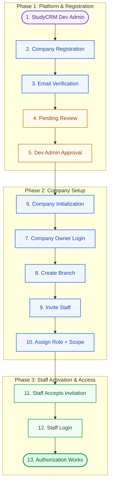
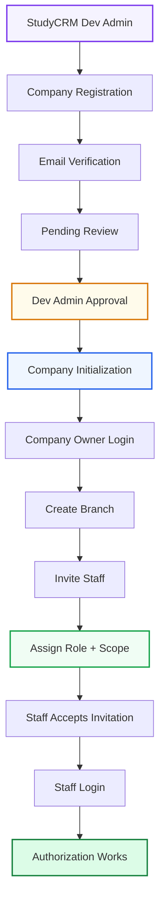

# StudyCRM Onboarding & Authorization Flow

A clean, high-level workflow of the StudyCRM multi-tenant lifecycle from platform administration to scoped staff authorization.

---

## 1. Clean Workflow Flowchart

---

## 2. Quick 1:1 Flow Reference

---

## 3. Flow-Wise Stage Summary

| # | Step | Actor | Summary |
| :-: | :--- | :--- | :--- |
| **1** | **StudyCRM Dev Admin** | Platform Admin | Manages SaaS platform, plans, and tenant review queues. |
| **2** | **Company Registration** | Agency | Submits agency name, work email, phone, and admin credentials. |
| **3** | **Email Verification** | System / User | Verifies email ownership via a 6-digit OTP code (5-min TTL). |
| **4** | **Pending Review** | System | Account enters audit queue with `PENDING_REVIEW` status. |
| **5** | **Dev Admin Approval** | Platform Admin | Dev Admin reviews agency credentials and approves tenant creation. |
| **6** | **Company Initialization** | System | Provisions isolated tenant database (`agency_id`), default roles, and settings. |
| **7** | **Company Owner Login** | Agency Owner | Owner logs into dedicated workspace with `Agency Admin` privileges. |
| **8** | **Create Branch** | Agency Owner | Sets up operating branches (e.g., Head Office, Regional Branch). |
| **9** | **Invite Staff** | Agency Owner | Sends single-use email invitation link to staff members. |
| **10** | **Assign Role + Scope** | Agency Owner | Assigns functional role (Counselor, Admissions) + scope (Branch, Global). |
| **11** | **Staff Accepts Invitation** | Staff User | Staff opens secure link, verifies identity, and creates their password. |
| **12** | **Staff Login** | Staff User | Staff logs in; system builds JWT session with assigned branch and scopes. |
| **13** | **Authorization Works** | Security Gateway | RBAC rules and data isolation filters are actively enforced on every action. |
