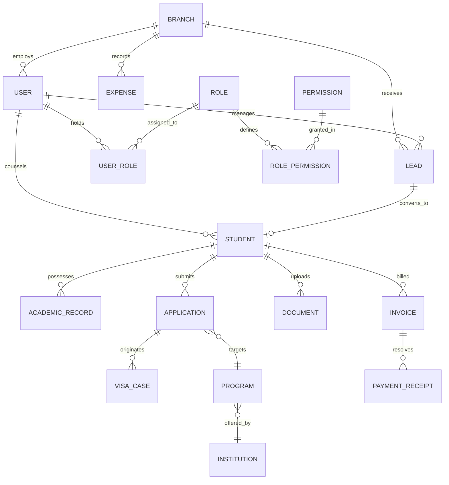

# Software Requirements Specification (SRS)
## For Study Track CRM (Study CRM Workspace)

**Document Reference:** `SRS-STRACK-2026-V3.0`  
**Standard:** IEEE Std 830-1998 / ISO/IEC/IEEE 29148:2018 Compliant  
**Initial Release Date:** 19 September 2026  
**Current Revision Date:** 25 October 2026  
**Status:** Approved & Baselined  
**Classification:** Confidential & Proprietary  

---

### Document Control & Revision History

| Version | Date | Author / Contributor | Description of Changes | Approved By |
| :--- | :--- | :--- | :--- | :--- |
| **1.0** | 19 Sep 2026 | Solution Architecture Team | Initial Draft: Core Lead & Student Workflow | Head of Operations |
| **2.0** | 08 Oct 2026 | Technical Lead & Systems Analyst | Added Multi-Application, Document Verification & Visa Cases | Lead Architect |
| **2.1** | 20 Oct 2026 | Security & Compliance Lead | Added Dynamic Role & Granular Permission System (RBAC) | CISO |
| **3.0** | 25 Oct 2026 | Core Engineering & Product Group | Full IEEE 830 Formal Restructure, Database DDL & Traceability | Executive Committee |

### Sign-off & Approval Matrix

| Role | Name | Title / Department | Signature / Status |
| :--- | :--- | :--- | :--- |
| **Product Owner** | T. H. Talukder | Chief Executive Officer (CEO) | *APPROVED* |
| **Project Manager** | Sarah Islam | Senior Recruitment & Operations Manager | *APPROVED* |
| **Lead Architect** | Engineering Lead | Enterprise Systems Division | *APPROVED* |
| **QA Director** | Quality Assurance Lead | Software Testing & Verification | *APPROVED* |

---

## Table of Contents
1. [Introduction](#1-introduction)
   - 1.1 [Purpose](#11-purpose)
   - 1.2 [Document Conventions](#12-document-conventions)
   - 1.3 [Intended Audience & Reading Suggestions](#13-intended-audience--reading-suggestions)
   - 1.4 [Project Scope](#14-project-scope)
   - 1.5 [Applicable Standards & References](#15-applicable-standards--references)
   - 1.6 [Definitions, Acronyms, and Abbreviations](#16-definitions-acronyms-and-abbreviations)
2. [Overall Description](#2-overall-description)
   - 2.1 [Product Perspective](#21-product-perspective)
   - 2.2 [Product Functions Summary](#22-product-functions-summary)
   - 2.3 [User Classes and Characteristics](#23-user-classes-and-characteristics)
   - 2.4 [Operating Environment](#24-operating-environment)
   - 2.5 [Design and Implementation Constraints](#25-design-and-implementation-constraints)
   - 2.6 [User Documentation](#26-user-documentation)
   - 2.7 [Assumptions and Dependencies](#27-assumptions-and-dependencies)
3. [System Features & Functional Requirements](#3-system-features--functional-requirements)
   - 3.1 [Authentication & Multi-Tenant Branch Management](#31-system-feature-authentication--multi-tenant-branch-management)
   - 3.2 [Dynamic Custom Role & Granular Permission Engine (RBAC)](#32-system-feature-dynamic-custom-role--granular-permission-engine-rbac)
   - 3.3 [Lead Capture, Deduping & Pipeline Engine](#33-system-feature-lead-capture-deduping--pipeline-engine)
   - 3.4 [Student Dossier & 360° Case Management](#34-system-feature-student-dossier--360-case-management)
   - 3.5 [Multi-Application Lifecycle Tracking](#35-system-feature-multi-application-lifecycle-tracking)
   - 3.6 [Document Review, Versioning & Quality Assurance](#36-system-feature-document-review-versioning--quality-assurance)
   - 3.7 [Visa Processing & Compliance Management](#37-system-feature-visa-processing--compliance-management)
   - 3.8 [Program Finder, Comparison & Eligibility Engine](#38-system-feature-program-finder-comparison--eligibility-engine)
   - 3.9 [Accounts, Service Invoicing & Commission Ledger](#39-system-feature-accounts-service-invoicing--commission-ledger)
   - 3.10 [Operations: Employee Attendance, Tasks & Appointments](#310-system-feature-operations-employee-attendance-tasks--appointments)
   - 3.11 [Communication Firewall & Student Self-Service Portal](#311-system-feature-communication-firewall--student-self-service-portal)
4. [External Interface Requirements](#4-external-interface-requirements)
   - 4.1 [User Interfaces (UI/UX)](#41-user-interfaces-uiux)
   - 4.2 [Hardware Interfaces](#42-hardware-interfaces)
   - 4.3 [Software Interfaces](#43-software-interfaces)
   - 4.4 [Communications Interfaces](#44-communications-interfaces)
5. [Non-Functional Requirements (NFR)](#5-non-functional-requirements-nfr)
   - 5.1 [Performance Requirements](#51-performance-requirements)
   - 5.2 [Safety & Backup Requirements](#52-safety--backup-requirements)
   - 5.3 [Security Requirements](#53-security-requirements)
   - 5.4 [Software Quality Attributes](#54-software-quality-attributes)
   - 5.5 [Core Business Rules (BR)](#55-core-business-rules-br)
6. [Data Requirements & Logical Schema](#6-data-requirements--logical-schema)
   - 6.1 [Logical Entity-Relationship Diagram](#61-logical-entity-relationship-diagram)
   - 6.2 [Data Dictionary & PostgreSQL DDL](#62-data-dictionary--postgresql-ddl)
7. [Verification & Traceability Matrix](#7-verification--traceability-matrix)
   - 7.1 [Requirements Traceability Matrix (RTM)](#71-requirements-traceability-matrix-rtm)
   - 7.2 [Acceptance Test Cases](#72-acceptance-test-cases)

---

## 1. Introduction

### 1.1 Purpose
This Software Requirements Specification (SRS) establishes the complete operational, functional, behavioral, and non-functional baseline for **Study Track CRM (Study CRM Workspace)**, Version 3.0. This document serves as the binding contract between business stakeholders, software architects, implementation engineers, quality assurance teams, and system administrators.

### 1.2 Document Conventions
This specification complies with the standard conventions of IEEE Std 830-1998 and RFC 2119.
- **Requirement Identifiers:** Unique alphanumeric tags in the form `REQ-[MODULE]-[NUMBER]` (e.g., `REQ-LEAD-001`, `REQ-RBAC-004`).
- **Modal Verbs (RFC 2119):**
  - **SHALL / MUST:** Denotes an absolute, mandatory requirement for system compliance.
  - **SHOULD / RECOMMENDED:** Denotes a valid design recommendation that may be overridden only after architectural justification.
  - **MAY / OPTIONAL:** Denotes an elective capability.
  - **SHALL NOT / MUST NOT:** Denotes an absolute prohibition.
- **Priority Classification (MoSCoW):** Every requirement is designated as **Must Have (M)**, **Should Have (S)**, **Could Have (C)**, or **Won't Have (W)** for initial baseline releases.

### 1.3 Intended Audience & Reading Suggestions
1. **Executive Stakeholders / CEO:** Read Section 1 (Vision), Section 2.2 (Functions), and Section 5.5 (Business Rules).
2. **Software Developers & Architects:** Read Section 2, Section 3 (System Features in full detail), Section 4, Section 5, and Section 6 (Data Schema).
3. **Quality Assurance & Verification Teams:** Focus on Section 3 (Stimulus/Response), Section 5, and Section 7 (Acceptance & Traceability Matrix).
4. **Operations & Branch Managers:** Review Section 2.3 (User Classes), Section 3.2 (RBAC), and Section 3.10 (Operations).

### 1.4 Project Scope
Study Track CRM is an integrated, multi-branch Enterprise Resource Planning (ERP) and Customer Relationship Management (CRM) platform engineered exclusively for study-abroad agencies and educational consulting firms.

#### In-Scope:
- Multi-branch operational management (Dhaka Head Office, Tangail Branch, and future subsidiaries).
- Unified multi-channel lead ingestion with algorithmic deduplication.
- Visual Kanban-based student recruitment and case-intake pipelines.
- Multi-application university tracking with independent visa compliance modules.
- Document repository featuring version control (`v1`, `v2`, etc.), inline quality screening, and correction feedback.
- Program search catalogue featuring multi-factor filters and real-time student academic eligibility evaluation.
- Local currency (BDT) agency service invoicing alongside multi-currency institutional commission aging and office expense ledgers.
- Dynamic custom role creation with three-tier granular data scoping (`OWN`, `BRANCH`, `GLOBAL`).
- Separate, secure, read-only/upload-enabled Student Self-Service Portal.

#### Out-of-Scope (Deferred to Future Revisions):
- Direct programmatic submission into sovereign immigration databases (e.g., direct API injection into IRCC Canada or Australian Home Affairs).
- Automated AI-driven visa guarantee algorithms.
- Core banking ledger integration for international wire transfers (remittance recorded via manual credit advice reconciliation).

### 1.5 Applicable Standards & References
1. **IEEE Std 830-1998:** IEEE Recommended Practice for Software Requirements Specifications.
2. **ISO/IEC/IEEE 29148:2018:** Systems and software engineering — Life cycle processes — Requirements engineering.
3. **RFC 2119:** Key words for use in RFCs to Indicate Requirement Levels.
4. **OWASP Top 10 (2021):** Open Web Application Security Project Standards for Web Application Security.
5. **GDPR / Bangladesh Cyber Security & Data Privacy Guidelines:** Principles regarding personal student identity data handling.

### 1.6 Definitions, Acronyms, and Abbreviations

| Term / Acronym | Definition |
| :--- | :--- |
| **CAS** | Confirmation of Acceptance for Studies (UK Student Visa prerequisite). |
| **CoE** | Confirmation of Enrolment (Australian Student Visa prerequisite). |
| **CRM** | Customer Relationship Management system. |
| **Dossier** | The centralized, complete master record of a student containing all biographical, academic, financial, application, and visa records. |
| **ERD** | Entity-Relationship Diagram. |
| **GIC** | Guaranteed Investment Certificate (Canadian SDS visa financial requirement). |
| **GS / GTE** | Genuine Student / Genuine Temporary Entrant requirement (Australia). |
| **I-20** | Certificate of Eligibility for Nonimmigrant Student Status (USA). |
| **LOA** | Letter of Acceptance (Canada). |
| **MFS** | Mobile Financial Services (e.g., bKash, Nagad, Rocket). |
| **MIME** | Multipurpose Internet Mail Extensions (file format validation standard). |
| **MFA** | Multi-Factor Authentication. |
| **P&L** | Profit and Loss financial statement. |
| **RBAC** | Role-Based Access Control. |
| **RTM** | Requirements Traceability Matrix. |
| **SDS** | Student Direct Stream (Expedited Canadian study permit category). |
| **SLA** | Service Level Agreement. |
| **TTL** | Time-To-Live (token/session expiration duration). |
| **VFS** | Visa Facilitation Services (Biometric and consular collection agency). |

---

## 2. Overall Description

### 2.1 Product Perspective
Study Track CRM operates as a centralized Software-as-a-Service (SaaS) web application running in a high-availability cloud architecture. It replaces disconnected spreadsheets, local filing cabinets, and generic CRM systems with an integrated case workflow designed specifically for overseas education consultancy.

```
+--------------------------------------------------------------------------------------------------------+
|                                  STUDY TRACK ENTERPRISE ECOSYSTEM                                      |
+--------------------------------------------------------------------------------------------------------+
|   PUBLIC INGESTION      |                     CORE CRM PLATFORM                     |  EXTERNAL APIS   |
|                         |                                                           |                  |
| [ Website Form ]        |  +--------------------+  +-----------------------------+  | [ WhatsApp Cloud]|
| [ Facebook Lead Ads ] --+->| Ingestion & Dedup  |->| Multi-Branch Workspaces     |--+-> [ Mailgun/SES] |
| [ Walk-in Inquiries ]   |  +--------------------+  | (Dhaka HQ / Tangail Branch) |  | [ AWS S3/Storage]|
|                         |                          +-----------------------------+  | [ SSLCommerz MFS]|
|                         |                          | - Leads & Student Dossiers  |  |                  |
|                         |                          | - Applications & Visas      |  |                  |
|                         |                          | - Document Verification     |  |                  |
|   STUDENT ACCESS        |                          | - Invoicing & Commissions   |  |                  |
|                         |                          +-----------------------------+  |                  |
| [ Student Self-Service ]|  +--------------------+                 |                 |                  |
| [ Mobile / Desktop Web] +->| Auth & OTP Engine  |-----------------+                 |                  |
|                         |  +--------------------+                                   |                  |
+--------------------------------------------------------------------------------------------------------+
```

### 2.2 Product Functions Summary
1. **Lead Lifecycle Engine:** Multi-source capture, E.164 normalization, collision screening, and Kanban-based phase migration.
2. **Student 360° Repository:** Immutable master dossiers containing personal, emergency, passport, academic history, and application records.
3. **Multi-Application Hub:** Parallel multi-institution tracking with automated task generation and deadline alerts.
4. **Quality Assurance Document Verification:** Multi-tier file checklist with version control, reviewer sign-offs, and corrective loop alerts.
5. **Program Search & Algorithmic Matchmaker:** Real-time program finder filtering by budget, tests, and academic cutoffs, featuring a side-by-side comparison matrix.
6. **Finance & Dual Ledger:** Client agency fee billing (BDT) isolated from foreign currency institutional commission receivables (AUD, CAD, GBP, EUR, USD).
7. **Dynamic Role Builder (RBAC):** Customizable security profiles featuring module-level action permissions and 3-tier data scopes (`OWN`, `BRANCH`, `GLOBAL`).
8. **Student Portal:** Transparent status tracker, document replacement upload station, invoice review, and direct counselor messaging.

### 2.3 User Classes and Characteristics

| User Class | Typical User | Technical Expertise | System Rights & Scope |
| :--- | :--- | :--- | :--- |
| **Super Admin** | CEO / Managing Director / System Architect | Advanced | Global organization oversight; full configuration; system audit; financial ledger control; dynamic role setup. |
| **Branch Manager** | Head of Branch (Dhaka / Tangail) | Intermediate | Manages branch staff; reassigns leads; approves branch office expenses; oversees branch conversions and attendance. |
| **Senior Counselor** | Educational Counselor / Case Lead | Intermediate | Manages assigned leads; conducts profile evaluations; matches programs; creates application drafts. |
| **Admissions Officer** | University Application Specialist | Intermediate | Performs technical reviews of academic documents; officially lodges applications; records university decisions. |
| **Visa Officer** | Visa & Compliance Specialist | Advanced | Prepares country-specific visa files; screens financial affidavits; schedules biometrics; records visa outcomes. |
| **Finance Officer** | Agency Accountant | Intermediate | Issues service invoices; records MFS/cash receipts; tracks institutional commission aging; reviews expense claims. |
| **Student** | Overseas Applicant / Parent | Novice | Restricted to self-service portal: views own application status, uploads requested documents, pays service fees. |

### 2.4 Operating Environment
- **Server Platform:** Linux (Ubuntu 22.04 LTS / Debian 12), Node.js LTS runtime / Python runtime.
- **Database Engine:** PostgreSQL 15+ (Relational engine with JSONB support for dynamic schemas).
- **Client Web Browsers:** Modern evergreen browsers: Google Chrome (v110+), Mozilla Firefox (v110+), Apple Safari (v16+), Microsoft Edge (v110+).
- **Client Devices:** Responsive viewport reflow down to $360\text{px}$ width (smartphones, tablets, laptops, multi-monitor desktop workstations).
- **File Storage Infrastructure:** Private cloud object store (AWS S3 / Google Cloud Storage / MinIO) enforcing strict private-bucket policies.

### 2.5 Design and Implementation Constraints
1. **Regulatory Compliance:** Adherence to Bangladesh Information and Communication Technology laws and international principles of GDPR regarding student personal identifiable information (PII).
2. **Data Residency & Security:** All communication over public networks must use TLS 1.3 encryption. Passwords and credentials must never be stored in plaintext.
3. **Network Constraints:** The system must remain fully functional and responsive over standard mobile broadband ($3\text{G}/4\text{G}$ connections with latency up to $300\text{ ms}$).
4. **Zero Data Leakage:** Counselor internal evaluation remarks, agency commission margins, and other students' dossiers must never be exposed over public-facing APIs.

### 2.6 User Documentation
The system shall deliver:
- Integrated contextual help tooltips for complex eligibility and visa rules.
- Administrator guide for dynamic role configuration and branch setup.
- Interactive student onboarding guide within the self-service portal.

### 2.7 Assumptions and Dependencies
- Agency branches maintain stable internet connectivity.
- Third-party email delivery services (Mailgun/SendGrid/SES) and WhatsApp Business API maintain $\ge 99.5\%$ operational uptime.
- Institutional program requirements and tuition fees in the catalogue are updated and verified periodically by admissions personnel.

---

## 3. System Features & Functional Requirements

```
                                  SYSTEM FEATURE ARCHITECTURE
+-------------------------------------------------------------------------------------------------------+
|  3.1 AUTHENTICATION & MULTI-BRANCH WORKSPACES                                                         |
|      +-- REQ-AUTH-001 (Multi-Factor Login)         +-- REQ-AUTH-002 (Branch Tenant Context)           |
+-------------------------------------------------------------------------------------------------------+
|  3.2 DYNAMIC CUSTOM ROLES & RBAC ENGINE                                                               |
|      +-- REQ-RBAC-001 (Role Definition)            +-- REQ-RBAC-002 (3-Tier Scope Modifiers)          |
|      +-- REQ-RBAC-003 (Matrix Authorization Engine)+-- REQ-RBAC-004 (Anti-Privilege Escalation)       |
+-------------------------------------------------------------------------------------------------------+
|  3.3 LEAD CAPTURE & RECRUITMENT PIPELINE                                                              |
|      +-- REQ-LEAD-001 (Normalized Ingestion)       +-- REQ-LEAD-002 (Collision Screening)            |
|      +-- REQ-LEAD-003 (Academic Matrix Capture)    +-- REQ-LEAD-004 (Visual Kanban Stage Machine)     |
+-------------------------------------------------------------------------------------------------------+
|  3.4 STUDENT DOSSIER (360° MANAGEMENT)             |  3.5 MULTI-APPLICATION HUB                      |
|      +-- REQ-STU-001 (Master Dossier Generator)    |      +-- REQ-APP-001 (Multi-App Binding)         |
|      +-- REQ-STU-002 (Conversion Gate Gating)      |      +-- REQ-APP-002 (State Progression Machine) |
|      +-- REQ-STU-003 (PDF Dossier Export Engine)   |      +-- REQ-APP-003 (SLA Action Due Alerter)    |
+----------------------------------------------------+--------------------------------------------------+
|  3.6 DOCUMENT VERIFICATION & QUALITY QA            |  3.7 VISA PROCESSING & COMPLIANCE                |
|      +-- REQ-DOC-001 (Country Checklist Repository)|      +-- REQ-VISA-001 (Case Milestone Workflow)  |
|      +-- REQ-DOC-002 (Immutable Version Trees)     |      +-- REQ-VISA-002 (Compliance Screeners)     |
|      +-- REQ-DOC-003 (Reviewer Action Loop)        |      +-- REQ-VISA-003 (Decision & Refusal Archive)|
+----------------------------------------------------+--------------------------------------------------+
|  3.8 PROGRAM FINDER & MATCHMAKING                  |  3.9 ACCOUNTS, INVOICING & COMMISSIONS           |
|      +-- REQ-PROG-001 (Multi-Facet Filter Engine)  |      +-- REQ-FIN-001 (Agency Service Invoicing)  |
|      +-- REQ-PROG-002 (Side-by-Side Comparison)    |      +-- REQ-FIN-002 (Foreign Commission Aging)  |
|      +-- REQ-PROG-003 (Algorithmic Fit Checker)    |      +-- REQ-FIN-003 (Office Expense Approval)   |
+----------------------------------------------------+--------------------------------------------------+
|  3.10 OPERATIONS & AGENCY GOVERNANCE               |  3.11 COMMUNICATION & STUDENT PORTAL             |
|      +-- REQ-OPS-001 (Biometric/IP Attendance Clock|      +-- REQ-PORT-001 (Student Tracker Station)  |
|      +-- REQ-OPS-002 (Task & Appointment Dispatch) |      +-- REQ-COMM-001 (Dual-Channel Firewall)    |
|      +-- REQ-OPS-003 (Inter-Branch Lead Handover)  |      +-- REQ-COMM-002 (WhatsApp/SMS Event Dispatch|
+-------------------------------------------------------------------------------------------------------+
```

---

### 3.1 System Feature: Authentication & Multi-Tenant Branch Management

#### 3.1.1 Description & Priority
Governs secure authentication, cryptographic session issuance, and multi-branch tenant data isolation.  
**Priority:** Must Have (M).

#### 3.1.2 Stimulus / Response Sequences
- **Stimulus:** Staff user submits email and password from the login interface.
- **Response:** System validates credentials, verifies branch assignment, issues a signed JWT containing assigned roles and permissions, and routes user to their designated branch view.
- **Stimulus:** User enters an invalid password 5 consecutive times.
- **Response:** System locks user account for 15 minutes and writes an alert record to `security_audit_logs`.

#### 3.1.3 Functional Requirements
- **REQ-AUTH-001:** The system SHALL authenticate users using email and cryptographically hashed passwords (`bcrypt`, work factor $\ge 12$).
- **REQ-AUTH-002:** The system SHALL enforce Multi-Factor Authentication (MFA) via a 6-digit Time-based One-Time Password (TOTP) or SMS/Email verification for all staff accounts holding financial, administrative, or managerial privileges.
- **REQ-AUTH-003:** The system SHALL inject the authenticated user's active `branch_id`, `role_ids`, and permission dictionary directly into the backend session context to enforce operational tenancy.
- **REQ-AUTH-004:** The system SHALL automatically invalidate web sessions after 30 minutes of continuous user inactivity.

---

### 3.2 System Feature: Dynamic Custom Role & Granular Permission Engine (RBAC)

#### 3.2.1 Description & Priority
Enables executive management to create, name, configure, and assign custom roles with fine-grained action permissions and 3-tier data scoping modifiers without altering underlying codebase.  
**Priority:** Must Have (M).

#### 3.2.2 Stimulus / Response Sequences
- **Stimulus:** Super Admin submits a new role creation request named *"Tangail Senior Counselor"* with `leads.view` (Scope: `BRANCH`) and `apps.create` (Scope: `OWN`).
- **Response:** System validates uniqueness, persists role record to `roles`, inserts mappings to `role_permissions`, and immediately enables this role in the employee assignment dropdown.
- **Stimulus:** A user assigned to *"Tangail Senior Counselor"* attempts to query an API endpoint retrieving Dhaka branch leads (`GET /api/leads?branch=dhaka`).
- **Response:** Backend authorization middleware intercepts the request, evaluates the branch context, and returns an HTTP 403 Forbidden payload.

#### 3.2.3 Functional Requirements
- **REQ-RBAC-001:** The system SHALL maintain immutable System Roles (`Super Admin`, `Student Portal User`) that cannot be deleted, renamed, or stripped of core permissions.
- **REQ-RBAC-002:** The system SHALL provide a Dynamic Role Builder interface allowing authorized managers to input a custom `Role Name`, `Description`, and assign granular permission items.
- **REQ-RBAC-003:** Every permission entry assigned to a custom role SHALL incorporate one of three mutually exclusive Data Scope modifiers:
  1. `OWN`: Restricts data access strictly to records where `assigned_to == user.id`.
  2. `BRANCH`: Restricts data access to records matching the user's assigned branch (`record.branch_id == user.branch_id`).
  3. `GLOBAL`: Grants organization-wide access across all branches.
- **REQ-RBAC-004:** The system SHALL enforce an Anti-Privilege Escalation rule: No user SHALL be capable of creating or editing a role that contains permissions or scopes exceeding the user's own current access rights.
- **REQ-RBAC-005:** The system SHALL restrict the assignment of `finance.view_commissions` and `rbac.manage_roles` exclusively to users holding the `Super Admin` role.
- **REQ-RBAC-006:** The system SHALL prevent the deletion of any role if one or more active employees remain assigned to it.
- **REQ-RBAC-007:** When a user is assigned multiple roles, the system authorization layer SHALL compute the mathematical union of all granted permissions, resolving scope conflicts in favor of the highest scope (`GLOBAL` > `BRANCH` > `OWN`).

---

### 3.3 System Feature: Lead Capture, Deduping & Pipeline Engine

#### 3.3.1 Description & Priority
Captures prospective student inquiries across all intake channels, normalizes contact identifiers, detects duplicates, and presents an interactive Kanban pipeline.  
**Priority:** Must Have (M).

#### 3.3.2 Stimulus / Response Sequences
- **Stimulus:** Web form webhook or counselor creates a new lead with phone `01732423242`.
- **Response:** System normalizes number to `+8801732423242`, queries database for collisions, creates record `ST-1024`, assigns initial stage `New Enquiry`, and alerts intake officer.
- **Stimulus:** Counselor inputs an identical phone or email matching an existing lead or student.
- **Response:** System displays collision alert modal, shows link to existing dossier, and appends the new inquiry source to the existing record's timeline without creating a duplicate.

#### 3.3.3 Functional Requirements
- **REQ-LEAD-001:** The system SHALL ingest leads containing mandatory fields: `Full Name`, `Contact Phone`, `Branch`, `Target Destination`, and `Source Channel`.
- **REQ-LEAD-002:** The system SHALL execute algorithmic deduplication on every lead creation attempt:
  - Phone numbers SHALL be normalized to E.164 international standard.
  - Emails SHALL be trimmed and normalized to lowercase.
  - If a collision occurs against an existing `lead` or `student`, creation SHALL be rejected, and the existing file's activity feed SHALL be appended.
- **REQ-LEAD-003:** The system SHALL support capturing an Academic Credentials Matrix for every lead:
  - Prior Exams: SSC/O-Level, HSC/A-Level/Diploma, Bachelor, Master's.
  - Academic metadata: Passing Year, Board/University, Result/CGPA, Scale.
  - English Language Test: Type (IELTS, PTE, TOEFL, DET, None), Overall Score, Band breakdown (Listening, Reading, Writing, Speaking).
- **REQ-LEAD-004:** The system SHALL provide a drag-and-drop visual Kanban pipeline rendering stages: `New Enquiry` $\rightarrow$ `Counseling` $\rightarrow$ `Interested` $\rightarrow$ `Application Ready` $\rightarrow$ `File Opening`.
- **REQ-LEAD-005:** The system SHALL record an immutable audit entry whenever a lead is moved across stages or reassigned to a different counselor.

---

### 3.4 System Feature: Student Dossier & 360° Case Management

#### 3.4.1 Description & Priority
Serves as the single source of truth for an enrolled student applicant, binding academic history, passport identity, applications, documents, payments, and case notes.  
**Priority:** Must Have (M).

#### 3.4.2 Stimulus / Response Sequences
- **Stimulus:** Counselor drags a lead card into `File Opening`.
- **Response:** System verifies all mandatory conversion fields (`BR-02.1`), generates permanent identifier `STU-26DHK-0248`, initializes empty document checklist, and creates master dossier.
- **Stimulus:** Counselor clicks "Export PDF Dossier".
- **Response:** System compiles personal details, academic history, test scores, application states, and verified document summaries into a branded PDF document.

#### 3.4.3 Functional Requirements
- **REQ-STU-001:** The system SHALL issue a permanent, unique student identification number upon file opening matching format: `STU-[YY][BRANCH_CODE]-[0-9]{4}` (e.g., `STU-26DHK-0248`).
- **REQ-STU-002:** The system SHALL block conversion of a lead into a student unless the following fields are completed: Legal Full Name, Verified Email, WhatsApp Phone, Prior Academic Qualification with GPA/Result, Target Country, Target Intake, and Declared Budget.
- **REQ-STU-003:** The Student Master Dossier SHALL provide 5 synchronized operational tabs:
  1. `Overview`: Personal info, emergency contacts, passport details, sponsor information.
  2. `Applications`: Tabular tracking of all university applications.
  3. `Documents`: Categorized document verification checklist.
  4. `Payments`: Service fee invoices, payment receipts, balance status.
  5. `Notes & Timeline`: Chronological activity stream of counselor calls, status shifts, and meeting notes.
- **REQ-STU-004:** The system SHALL provide an automated PDF export engine capable of generating a standardized, agency-branded Student Case Profile summary document.

---

### 3.5 System Feature: Multi-Application Lifecycle Tracking

#### 3.5.1 Description & Priority
Tracks multiple simultaneous university submissions per student across different institutions, terms, and destinations with strict state progression rules.  
**Priority:** Must Have (M).

#### 3.5.2 Stimulus / Response Sequences
- **Stimulus:** Admissions Officer creates an application for Harbour University for Master of Business, February 2027 intake.
- **Response:** System generates application code `APP-2401`, binds it to the student record, and sets initial status to `Draft`.
- **Stimulus:** Counselor attempts to lodge application to university while Bachelor transcript is marked `Needs Correction`.
- **Response:** System blocks status progression and renders an alert: *"Cannot transition to Submitted: Mandatory academic documents are not verified."*

#### 3.5.3 Functional Requirements
- **REQ-APP-001:** The system SHALL support creating $N$ independent university application records (`APP-XXXX`) under a single student master record.
- **REQ-APP-002:** Each application record SHALL capture: `Target Institution`, `Program Title`, `Study Level`, `Intake Month & Year`, `Application Fee & Currency`, `Current Stage`, and `Action Due Date`.
- **REQ-APP-003:** The system SHALL enforce an automated sequential state machine:
  $$\text{Draft} \longrightarrow \text{Under Review} \longrightarrow \text{Ready to Submit} \longrightarrow \text{Submitted} \longrightarrow \begin{cases} \text{Conditional Offer} \\ \text{Unconditional Offer} \\ \text{Rejected} \end{cases} \longrightarrow \text{Deposit Pending} \longrightarrow \text{Enrolled}$$
- **REQ-APP-004:** The system SHALL prohibit transitioning an application to `Submitted` unless all mandatory application documents for that institution possess a `Verified` status badge.
- **REQ-APP-005:** The system SHALL compute an Action Due SLA indicator for every active application:
  - Green Tag: Action due in $>3$ business days.
  - Orange Tag (`st-warn`): Action due within 48 hours.
  - Red Tag (`st-danger`): Action overdue; triggers an automated notification to the Branch Manager.

---

### 3.6 System Feature: Document Review, Versioning & Quality Assurance

#### 3.6.1 Description & Priority
Manages the uploading, screening, version archiving, and verification of student identity, academic, language, and financial records.  
**Priority:** Must Have (M).

#### 3.6.2 Stimulus / Response Sequences
- **Stimulus:** Student uploads replacement file for Bachelor Transcript via the student portal.
- **Response:** System archives existing file as `v1`, marks replacement as `v2`, sets review status to `In Review`, and notifies the assigned admissions officer.
- **Stimulus:** Admissions officer marks a document as `Needs Correction` with note: *"Missing final semester grade sheet."*
- **Response:** System flags document badge as orange (`Needs Correction`), updates timestamp, and displays an alert banner on the student portal.

#### 3.6.3 Functional Requirements
- **REQ-DOC-001:** The system SHALL categorize all documents under: `Identity`, `Academic`, `Language`, `Financial`, and `Visa Case Evidence`.
- **REQ-DOC-002:** The system SHALL enforce an immutable version control tree (`v1`, `v2`, `v3`, etc.) for every document slot. Prior versions SHALL remain accessible to authorized staff for audit purposes.
- **REQ-DOC-003:** The system SHALL support 4 distinct review statuses: `Missing`, `In Review`, `Needs Correction`, and `Verified`.
- **REQ-DOC-004:** Marking a document as `Needs Correction` SHALL mandate the input of a textual correction note explaining the deficiency.
- **REQ-DOC-005:** Marking a document as `Verified` SHALL stamp the record with the reviewer's User ID, timestamp, and lock the document against deletion.
- **REQ-DOC-006:** The system SHALL restrict file uploads strictly to MIME types `application/pdf`, `image/jpeg`, and `image/png` with a maximum file size threshold of $10\text{ MB}$.
- **REQ-DOC-007:** The system SHALL deliver document files strictly via temporary pre-signed object URLs with an expiration TTL not exceeding 15 minutes.

---

### 3.7 System Feature: Visa Processing & Compliance Management

#### 3.7.1 Description & Priority
Governs post-admission visa file compilation, financial solvency screening, biometrics tracking, and embassy decision recording.  
**Priority:** Must Have (M).

#### 3.7.2 Stimulus / Response Sequences
- **Stimulus:** Application stage updates to `Deposit Pending` with tuition receipt confirmed.
- **Response:** System unlocks the `Visa Cases` module for the student, initializes destination-specific compliance checklist, and assigns a Visa Processing Officer.
- **Stimulus:** Visa officer marks case as `Visa Granted` with embassy reference number.
- **Response:** System updates student case tag to `Enrolled / Visa Granted`, issues an arrival task checklist, and triggers expected commission calculation in Finance.

#### 3.7.3 Functional Requirements
- **REQ-VISA-001:** The system SHALL initialize a Visa Case record only after an application achieves `Conditional Offer` (with conditions met) or `Unconditional Offer` and records verified tuition deposit payment.
- **REQ-VISA-002:** The system SHALL dynamically render country-specific visa compliance checklists:
  - **Canada:** SDS checklist (GIC verification, upfront medical confirmation, full Year 1 tuition receipt).
  - **Australia:** Genuine Student (GS) evaluation, sponsor relationship proof, fund availability matrix.
  - **UK / Europe:** Financial maintenance duration (28-day rule), TB test certificate, CAS verification.
- **REQ-VISA-003:** The system SHALL record visa milestone dates: `File Lodged Date`, `Biometrics/VFS Date`, `Interview Date` (if applicable), `Visa Outcome Date`, `Visa Grant/Refusal Reference Number`.
- **REQ-VISA-004:** In the event of a visa refusal, the system SHALL mandate the upload of the official embassy refusal letter and record the specific refusal ground without deleting historical case data.

---

### 3.8 System Feature: Program Finder, Comparison & Eligibility Engine

#### 3.8.1 Description & Priority
Provides a searchable institution and course catalogue featuring multi-criteria filtering, side-by-side program comparison, and automated student academic fit evaluation.  
**Priority:** Should Have (S).

#### 3.8.2 Stimulus / Response Sequences
- **Stimulus:** Counselor filters catalogue by Destination: `Australia`, Intake: `February 2027`, Level: `Postgraduate`, Max Budget: `35000 AUD`.
- **Response:** System renders matching course cards displaying institution, annual fee, IELTS/PTE criteria, and intake status.
- **Stimulus:** Counselor clicks "Check Eligibility" for student Ayesha Rahman against Harbour University Master of Business.
- **Response:** System computes student GPA and IELTS bands against course rules and displays an interactive match/deficit table.

#### 3.8.3 Functional Requirements
- **REQ-PROG-001:** The system SHALL provide a multi-facet search engine filtering by: `Destination Country`, `Region/State`, `Program Level`, `Field of Study`, `Intake Term & Year`, `Annual Tuition Budget`, and `Tuition Currency`.
- **REQ-PROG-002:** The system SHALL support specialized admission boolean filter flags: `Scholarship Available`, `Application Fee Waiver Route`, `Open for Applications`, `STEM Designated`, `ESL/Pathway Included`, `No GRE Required`, `No Maths Prerequisite`, `Medium of Instruction (MOI) English Waiver`, `15-Year Education Accepted`.
- **REQ-PROG-003:** The system SHALL support selecting up to three (3) programs simultaneously and rendering a side-by-side comparative matrix.
- **REQ-PROG-004:** The system SHALL execute an automated Eligibility Fit Algorithm comparing active student profile attributes against program requirements:
  1. *Qualification Match:* Compares student degree level vs program prerequisite.
  2. *Academic Cutoff:* Compares student CGPA/Percentage vs program minimum.
  3. *English Overall & Sub-bands:* Compares test scores (IELTS/PTE) and flags any sub-band deficit.
  4. *Budget Feasibility:* Compares declared annual budget against program annual tuition.
- **REQ-PROG-005:** The eligibility engine SHALL render results using standard indicators: `Match` (Green tag), `Below Requirement` (Orange tag with specific deficit details), or `Funding Gap`.

---

### 3.9 System Feature: Accounts, Service Invoicing & Commission Ledger

#### 3.9.1 Description & Priority
Administers agency service fee billing, MFS payment recording, partner institution commission aging, and branch office expense auditing.  
**Priority:** Must Have (M).

#### 3.9.2 Stimulus / Response Sequences
- **Stimulus:** Finance officer generates an invoice for student Ayesha Rahman for Application Support Service in the amount of BDT 5,000.
- **Response:** System issues invoice `ST-INV-026`, updates student financial balance, and reflects invoice on student portal.
- **Stimulus:** Student pays invoice via simulated/integrated mobile banking (bKash).
- **Response:** System records payment, transitions invoice to `Paid`, and issues PDF receipt `ST-RCP-026`.

#### 3.9.3 Functional Requirements
- **REQ-FIN-001:** The system SHALL maintain strict ledger isolation: Agency service fee transactions SHALL be maintained exclusively in local currency (BDT); University tuition deposits and institutional commissions SHALL be recorded in their respective foreign currencies (AUD, CAD, GBP, EUR, USD).
- **REQ-FIN-002:** The system SHALL generate agency service invoices with automated numbering (`ST-INV-[0-9]{4}`) tracking status: `Unpaid`, `Partially Paid`, `Paid`, `Cancelled`.
- **REQ-FIN-003:** The system SHALL issue formal payment receipts (`ST-RCP-[0-9]{4}`) upon recording payment confirmation via Mobile Banking (bKash/Nagad), Bank Wire, or Cash.
- **REQ-FIN-004:** The system SHALL track Institutional Commission Receivables across distinct financial lifecycle stages:
  $$\text{Forecast / Expected} \longrightarrow \text{Invoiced to University} \longrightarrow \text{Overdue (>30, >60 days)} \longrightarrow \text{Received / Cleared}$$
- **REQ-FIN-005:** Forecast institutional commissions SHALL NOT be counted as realized revenue until an official bank remittance credit advice is reconciled.
- **REQ-FIN-006:** Staff members SHALL be capable of submitting Branch Office Expense vouchers (`Description`, `Branch`, `Amount BDT`, `Receipt Attachment`). Expense claims SHALL require Branch Manager approval prior to posting into branch operational P&L.

---

### 3.10 System Feature: Operations: Employee Attendance, Tasks & Appointments

#### 3.10.1 Description & Priority
Coordinates daily staff presence, inter-branch task delegation, counseling appointment scheduling, and case reassignments.  
**Priority:** Should Have (S).

#### 3.10.2 Stimulus / Response Sequences
- **Stimulus:** Counselor clicks "Check In" upon arriving at the Dhaka office.
- **Response:** System records timestamp, client IP, and marks staff member as `Present` on the branch attendance board.
- **Stimulus:** Branch manager assigns a task: *"Verify bank statement for STU-0248"* with due date 21 September.
- **Response:** System dispatches task to counselor's task queue and schedules automated reminder 24 hours prior to deadline.

#### 3.10.3 Functional Requirements
- **REQ-OPS-001:** The system SHALL provide staff check-in and check-out attendance logging, recording exact server timestamp and client network IP address.
- **REQ-OPS-002:** The system SHALL provide a task management engine allowing supervisors to assign tasks linked to specific student files with due dates and priority tiers (`Urgent`, `Normal`, `Low`).
- **REQ-OPS-003:** If an assigned task reaches its deadline without being marked `Completed`, the system SHALL escalate the task tag to `Overdue` and trigger an alert to the Branch Manager.
- **REQ-OPS-004:** The system SHALL provide appointment scheduling for student counseling and document submission sessions with calendar conflict detection for counselors.
- **REQ-OPS-005:** The system SHALL record a formal handover audit log whenever a student file is transferred between branches (e.g., Tangail Branch to Dhaka Head Office).

---

### 3.11 System Feature: Communication Firewall & Student Self-Service Portal

#### 3.11.1 Description & Priority
Delivers a dedicated external portal for applicants while enforcing a strict data privacy firewall between internal staff notes and student-visible notices.  
**Priority:** Must Have (M).

#### 3.11.2 Stimulus / Response Sequences
- **Stimulus:** Counselor logs an internal assessment note: *"Student sponsor bank statement appears questionable; verify with tax documents."*
- **Response:** System saves note to internal case history; verifies privacy flag; ensures note is strictly excluded from student portal APIs.
- **Stimulus:** Counselor creates a student message: *"Please upload the missing final page of your transcript."*
- **Response:** System transmits message to the student portal and dispatches an automated notification alert.

#### 3.11.3 Functional Requirements
- **REQ-COMM-001:** The system SHALL enforce an architectural Data Privacy Firewall:
  - `Internal Notes`: Accessible only to authenticated agency personnel holding appropriate permissions.
  - `Student-Visible Messages`: Transparent updates, document remediation requests, and milestone notices displayed on the student portal.
- **REQ-PORT-001:** The Student Self-Service Portal SHALL provide authenticated students with:
  1. An 8-stage visual application progress tracker (*Created $\rightarrow$ Started $\rightarrow$ Reviewed $\rightarrow$ Submitted $\rightarrow$ Offer Received $\rightarrow$ Admission Processing $\rightarrow$ Pre-arrival $\rightarrow$ Arrival*).
  2. Document upload and replacement station.
  3. Invoice review and receipt download.
  4. Secure messaging channel with their assigned counselor.
- **REQ-PORT-002:** The student portal SHALL NOT display internal commission calculations, internal risk flags, university contact person emails, or other applicants' files under any operational condition.

---

## 4. External Interface Requirements

### 4.1 User Interfaces (UI/UX)
- **Design System Standards:** The user interface SHALL comply with modern design standards featuring high-contrast text ratios ($\ge 4.5:1$ per WCAG 2.1 AA), systematic typography (Inter / Roboto sans-serif stack), curved border radiuses ($8\text{px}$ to $16\text{px}$), and responsive CSS grid/flexbox layouts.
- **Theme Support:** Native light and dark color schemes via standard CSS custom properties (`light-dark()`, OkLab color mixing).
- **Navigation Architecture:** Fixed lateral sidebar with categorized menus:
  - *Main Menu:* Dashboard, Lead Pipeline, Students, Applications, Document Review, Visa Cases, Program Finder.
  - *Operations:* Tasks & Appointments, Communication, Accounts & Finance, Reports & Insights, Partner Institutes, Branches, Attendance, Team Management.
  - *Support:* Customer Support.
- **Interactive Feedback:** Contextual toast alerts (`st-ok`, `st-warn`, `st-danger`) for asynchronous transactions, inline field validation errors, and clear modal confirmation dialogues for destructive actions.

### 4.2 Hardware Interfaces
No dedicated hardware interfaces required. The platform operates on standard commercial computing equipment supporting modern web standards.

### 4.3 Software Interfaces
1. **Object Storage Service:** Amazon Web Services (AWS) S3 API / Google Cloud Storage API for encrypted document file persistence.
2. **Transactional Email Service:** SMTP / REST API integration (Mailgun, Amazon SES, or SendGrid) for OTP verification and automated deadline alerts.
3. **WhatsApp Business Cloud API:** Meta Graph API integration for automated template-based milestone notifications.
4. **Payment Gateway Integration:** SSLCommerz / bKash Merchant API for processing student service charges in Bangladeshi Taka (BDT).

### 4.4 Communications Interfaces
- **Network Protocol:** HTTPS enforcing Transport Layer Security (TLS 1.3). All unencrypted HTTP traffic SHALL be redirected to HTTPS with HTTP Strict Transport Security (HSTS) headers enabled.
- **API Architectural Style:** RESTful JSON APIs adhering to OpenAPI 3.0 standards.
- **Real-Time Data Channels:** WebSockets (WSS) / Server-Sent Events (SSE) for real-time task alerts and instant portal messaging.

---

## 5. Non-Functional Requirements (NFR)

### 5.1 Performance Requirements
- **REQ-NFR-PERF-01 (Catalog Search Latency):** Program Finder search queries filtering over a catalogue of 20,000 courses SHALL return complete results within $\le 600\text{ ms}$ under standard broadband.
- **REQ-NFR-PERF-02 (Dashboard Load Time):** Dashboard and Kanban board views SHALL achieve a 95th-percentile First Contentful Paint (FCP) of $\le 1.2\text{ seconds}$ for branches containing up to 50,000 student records.
- **REQ-NFR-PERF-03 (System Concurrency):** The production infrastructure SHALL sustain at least 300 concurrent staff users and 2,000 concurrent student portal users with zero HTTP 5xx error anomalies.

### 5.2 Safety & Backup Requirements
- **REQ-NFR-SAFE-01 (Automated Disaster Recovery):** The database engine SHALL execute automated snapshot backups daily with write-ahead log (WAL) archiving to guarantee Point-in-Time Recovery (PITR).
- **REQ-NFR-SAFE-02 (Recovery Metrics):** The system SHALL achieve a Recovery Point Objective (RPO) of $\le 1\text{ hour}$ and a Recovery Time Objective (RTO) of $\le 4\text{ hours}$ in the event of primary data center disruption.

### 5.3 Security Requirements
- **REQ-NFR-SEC-01 (Data Encryption):** All personal identifiable information (passport numbers, dates of birth, national identity numbers, and sponsor financial balances) SHALL be encrypted at rest using AES-256-GCM.
- **REQ-NFR-SEC-02 (Storage Security):** Document files stored in object storage buckets SHALL block public read access; all file access SHALL require pre-signed URLs expiring in $\le 15\text{ minutes}$.
- **REQ-NFR-SEC-03 (Authentication Security):** Passwords SHALL be hashed using `bcrypt` (work factor $\ge 12$). API access tokens SHALL expire in 15 minutes; refresh tokens SHALL expire in 7 days and employ single-use refresh token rotation.
- **REQ-NFR-SEC-04 (Vulnerability Hardening):** All input parameters SHALL be sanitized and bound via parameterized queries to eliminate SQL Injection (SQLi), Cross-Site Scripting (XSS), and Cross-Site Request Forgery (CSRF).

### 5.4 Software Quality Attributes
- **Availability:** The system SHALL guarantee $\ge 99.9\%$ operational uptime per calendar month, excluding scheduled maintenance windows announced 48 hours in advance.
- **Maintainability:** Codebases SHALL follow modular component architecture with comprehensive API documentation and strict separation of data access, business logic, and presentation tiers.
- **Usability:** All critical operations (creating a lead, submitting an application, approving a document) SHALL be executable in $\le 4$ user clicks from the dashboard.

### 5.5 Core Business Rules (BR)

| Rule ID | Rule Title | Formal Specification |
| :--- | :--- | :--- |
| **BR-01** | Lead Deduping & Collision | Incoming inquiries sharing an E.164 phone or lowercase email with an existing lead/student SHALL NOT generate a duplicate file; data SHALL append to the existing timeline. |
| **BR-02** | File Opening Gate | Transitioning a lead to `File Opening` mandates Full Name, Verified Phone, Email, Branch, Counselor, Valid Academic Record, Target Country, Target Intake, and Budget. |
| **BR-03** | Application Submission Gate | An application SHALL NOT transition to `Submitted` unless all mandatory application documents for that institution possess a `Verified` status badge. |
| **BR-04** | Document Immutability | Uploading a replacement document SHALL archive the existing file as `v[N]` and increment the active file to `v[N+1]`. Previous versions SHALL NOT be deleted. |
| **BR-05** | Financial Isolation | Agency fee invoices (BDT) and University Tuition/Commissions (foreign currency) SHALL be stored in separate ledger tables. Forecast commission is never recognized as collected revenue. |
| **BR-06** | Commission Privacy | Institutional commission rates, university agreements, and profit margins SHALL NEVER be exposed to Counselor, Student, or public API views. |
| **BR-07** | Custom Role Integrity | System roles cannot be deleted. Custom roles cannot grant permissions exceeding the creator's permissions. Active assigned roles cannot be deleted. |

---

## 6. Data Requirements & Logical Schema

### 6.1 Logical Entity-Relationship Diagram



---

### 6.2 Data Dictionary & PostgreSQL DDL

```sql
-- ============================================================================
-- 1. BRANCHES & MULTI-TENANCY
-- ============================================================================
CREATE TABLE branches (
    id SERIAL PRIMARY KEY,
    name VARCHAR(100) NOT NULL,
    code VARCHAR(10) UNIQUE NOT NULL, -- e.g., 'DHK', 'TGL'
    address TEXT NOT NULL,
    phone VARCHAR(30) NOT NULL,
    is_active BOOLEAN DEFAULT TRUE,
    created_at TIMESTAMP WITH TIME ZONE DEFAULT CURRENT_TIMESTAMP,
    updated_at TIMESTAMP WITH TIME ZONE DEFAULT CURRENT_TIMESTAMP
);

-- ============================================================================
-- 2. STAFF USERS & AUTHENTICATION
-- ============================================================================
CREATE TABLE users (
    id SERIAL PRIMARY KEY,
    branch_id INT NOT NULL REFERENCES branches(id) ON DELETE RESTRICT,
    name VARCHAR(100) NOT NULL,
    email VARCHAR(120) UNIQUE NOT NULL,
    password_hash VARCHAR(255) NOT NULL,
    phone VARCHAR(30),
    is_active BOOLEAN DEFAULT TRUE,
    failed_login_attempts INT DEFAULT 0,
    locked_until TIMESTAMP WITH TIME ZONE,
    created_at TIMESTAMP WITH TIME ZONE DEFAULT CURRENT_TIMESTAMP,
    updated_at TIMESTAMP WITH TIME ZONE DEFAULT CURRENT_TIMESTAMP
);

-- ============================================================================
-- 3. DYNAMIC ROLES & GRANULAR PERMISSIONS (RBAC)
-- ============================================================================
CREATE TABLE roles (
    id SERIAL PRIMARY KEY,
    name VARCHAR(100) NOT NULL,
    slug VARCHAR(100) UNIQUE NOT NULL,
    description TEXT,
    is_system BOOLEAN DEFAULT FALSE,
    branch_id INT REFERENCES branches(id) ON DELETE SET NULL, -- NULL = Global Role
    created_by INT REFERENCES users(id) ON DELETE SET NULL,
    created_at TIMESTAMP WITH TIME ZONE DEFAULT CURRENT_TIMESTAMP,
    updated_at TIMESTAMP WITH TIME ZONE DEFAULT CURRENT_TIMESTAMP
);

CREATE TABLE permissions (
    id SERIAL PRIMARY KEY,
    module VARCHAR(50) NOT NULL,   -- e.g., 'leads', 'students', 'apps', 'finance'
    action VARCHAR(50) NOT NULL,   -- e.g., 'view', 'create', 'edit', 'delete', 'verify'
    code VARCHAR(100) UNIQUE NOT NULL, -- e.g., 'leads.view', 'docs.verify'
    description TEXT
);

CREATE TABLE role_permissions (
    role_id INT NOT NULL REFERENCES roles(id) ON DELETE CASCADE,
    permission_id INT NOT NULL REFERENCES permissions(id) ON DELETE CASCADE,
    data_scope VARCHAR(20) NOT NULL DEFAULT 'BRANCH', -- 'OWN', 'BRANCH', 'GLOBAL'
    PRIMARY KEY (role_id, permission_id)
);

CREATE TABLE user_roles (
    user_id INT NOT NULL REFERENCES users(id) ON DELETE CASCADE,
    role_id INT NOT NULL REFERENCES roles(id) ON DELETE RESTRICT,
    assigned_at TIMESTAMP WITH TIME ZONE DEFAULT CURRENT_TIMESTAMP,
    assigned_by INT REFERENCES users(id) ON DELETE SET NULL,
    PRIMARY KEY (user_id, role_id)
);

-- ============================================================================
-- 4. LEADS & RECRUITMENT PIPELINE
-- ============================================================================
CREATE TABLE leads (
    id SERIAL PRIMARY KEY,
    lead_code VARCHAR(30) UNIQUE NOT NULL, -- e.g., 'ST-0324324'
    branch_id INT NOT NULL REFERENCES branches(id) ON DELETE RESTRICT,
    assigned_to INT REFERENCES users(id) ON DELETE SET NULL,
    name VARCHAR(100) NOT NULL,
    phone VARCHAR(30) NOT NULL,
    whatsapp VARCHAR(30),
    email VARCHAR(120),
    destination VARCHAR(50) NOT NULL,
    course_preference VARCHAR(150),
    budget_amount NUMERIC(12,2),
    stage VARCHAR(30) NOT NULL DEFAULT 'New Enquiry',
    source VARCHAR(50) NOT NULL,
    created_at TIMESTAMP WITH TIME ZONE DEFAULT CURRENT_TIMESTAMP,
    updated_at TIMESTAMP WITH TIME ZONE DEFAULT CURRENT_TIMESTAMP
);

-- ============================================================================
-- 5. STUDENT MASTER DOSSIERS
-- ============================================================================
CREATE TABLE students (
    id SERIAL PRIMARY KEY,
    student_code VARCHAR(30) UNIQUE NOT NULL, -- e.g., 'STU-26DHK-0248'
    lead_id INT UNIQUE REFERENCES leads(id) ON DELETE RESTRICT,
    branch_id INT NOT NULL REFERENCES branches(id) ON DELETE RESTRICT,
    counselor_id INT REFERENCES users(id) ON DELETE SET NULL,
    name VARCHAR(100) NOT NULL,
    dob DATE,
    gender VARCHAR(20),
    nationality VARCHAR(50) DEFAULT 'Bangladeshi',
    passport_no VARCHAR(50),
    passport_expiry DATE,
    passport_country VARCHAR(50) DEFAULT 'Bangladesh',
    status VARCHAR(30) DEFAULT 'Active',
    created_at TIMESTAMP WITH TIME ZONE DEFAULT CURRENT_TIMESTAMP,
    updated_at TIMESTAMP WITH TIME ZONE DEFAULT CURRENT_TIMESTAMP
);

CREATE TABLE academic_records (
    id SERIAL PRIMARY KEY,
    student_id INT NOT NULL REFERENCES students(id) ON DELETE CASCADE,
    exam_name VARCHAR(100) NOT NULL, -- SSC, HSC, Bachelor, Master's
    passing_year INT NOT NULL,
    institution_or_board VARCHAR(150) NOT NULL,
    grade_or_score NUMERIC(5,2) NOT NULL,
    scale NUMERIC(5,2) DEFAULT 4.00,
    created_at TIMESTAMP WITH TIME ZONE DEFAULT CURRENT_TIMESTAMP
);

CREATE TABLE language_tests (
    id SERIAL PRIMARY KEY,
    student_id INT NOT NULL REFERENCES students(id) ON DELETE CASCADE,
    test_type VARCHAR(20) NOT NULL, -- IELTS, PTE, TOEFL, DET
    overall_score NUMERIC(4,1) NOT NULL,
    listening NUMERIC(4,1),
    reading NUMERIC(4,1),
    writing NUMERIC(4,1),
    speaking NUMERIC(4,1),
    test_date DATE,
    created_at TIMESTAMP WITH TIME ZONE DEFAULT CURRENT_TIMESTAMP
);

-- ============================================================================
-- 6. PARTNER INSTITUTIONS, PROGRAMS & APPLICATIONS
-- ============================================================================
CREATE TABLE institutions (
    id SERIAL PRIMARY KEY,
    name VARCHAR(150) NOT NULL,
    country VARCHAR(50) NOT NULL,
    region VARCHAR(100),
    commission_rate_percent NUMERIC(5,2) DEFAULT 15.00, -- Confidentially locked
    created_at TIMESTAMP WITH TIME ZONE DEFAULT CURRENT_TIMESTAMP
);

CREATE TABLE programs (
    id SERIAL PRIMARY KEY,
    institution_id INT NOT NULL REFERENCES institutions(id) ON DELETE CASCADE,
    name VARCHAR(150) NOT NULL,
    degree_level VARCHAR(50) NOT NULL, -- Undergraduate, Postgraduate
    study_area VARCHAR(100) NOT NULL,  -- Business, Computing, Engineering
    intake_month VARCHAR(20) NOT NULL,
    intake_year VARCHAR(10) NOT NULL,
    duration VARCHAR(30) NOT NULL,
    annual_tuition NUMERIC(12,2) NOT NULL,
    currency VARCHAR(10) NOT NULL,
    min_qualification VARCHAR(50) NOT NULL,
    min_grade NUMERIC(5,2) NOT NULL,
    min_ielts_overall NUMERIC(3,1),
    min_ielts_band NUMERIC(3,1),
    min_pte_overall NUMERIC(4,1),
    min_pte_band NUMERIC(4,1),
    is_open BOOLEAN DEFAULT TRUE,
    is_stem BOOLEAN DEFAULT FALSE,
    is_scholarship_available BOOLEAN DEFAULT FALSE,
    created_at TIMESTAMP WITH TIME ZONE DEFAULT CURRENT_TIMESTAMP
);

CREATE TABLE applications (
    id SERIAL PRIMARY KEY,
    app_code VARCHAR(30) UNIQUE NOT NULL, -- e.g., 'APP-2401'
    student_id INT NOT NULL REFERENCES students(id) ON DELETE CASCADE,
    program_id INT NOT NULL REFERENCES programs(id) ON DELETE RESTRICT,
    stage VARCHAR(50) NOT NULL DEFAULT 'Draft',
    action_item VARCHAR(255),
    action_due_date DATE,
    offer_type VARCHAR(50), -- Conditional, Unconditional
    created_at TIMESTAMP WITH TIME ZONE DEFAULT CURRENT_TIMESTAMP,
    updated_at TIMESTAMP WITH TIME ZONE DEFAULT CURRENT_TIMESTAMP
);

-- ============================================================================
-- 7. DOCUMENTS & VERIFICATION
-- ============================================================================
CREATE TABLE documents (
    id SERIAL PRIMARY KEY,
    student_id INT NOT NULL REFERENCES students(id) ON DELETE CASCADE,
    app_id INT REFERENCES applications(id) ON DELETE SET NULL,
    name VARCHAR(150) NOT NULL,
    category VARCHAR(50) NOT NULL, -- Identity, Academic, Language, Financial, Visa
    storage_path TEXT NOT NULL,
    version INT NOT NULL DEFAULT 1,
    status VARCHAR(30) NOT NULL DEFAULT 'In Review', -- Missing, In Review, Needs Correction, Verified
    reviewer_notes TEXT,
    verified_by INT REFERENCES users(id) ON DELETE SET NULL,
    verified_at TIMESTAMP WITH TIME ZONE,
    created_at TIMESTAMP WITH TIME ZONE DEFAULT CURRENT_TIMESTAMP,
    updated_at TIMESTAMP WITH TIME ZONE DEFAULT CURRENT_TIMESTAMP
);

-- ============================================================================
-- 8. VISA CASES & COMPLIANCE
-- ============================================================================
CREATE TABLE visa_cases (
    id SERIAL PRIMARY KEY,
    student_id INT NOT NULL REFERENCES students(id) ON DELETE CASCADE,
    app_id INT UNIQUE NOT NULL REFERENCES applications(id) ON DELETE RESTRICT,
    country VARCHAR(50) NOT NULL,
    checklist_template VARCHAR(50) NOT NULL,
    stage VARCHAR(50) NOT NULL DEFAULT 'Document Preparation',
    embassy_reference_no VARCHAR(100),
    lodged_date DATE,
    biometrics_date DATE,
    decision_date DATE,
    outcome VARCHAR(30) DEFAULT 'Pending', -- Pending, Granted, Refused
    refusal_reason TEXT,
    created_at TIMESTAMP WITH TIME ZONE DEFAULT CURRENT_TIMESTAMP,
    updated_at TIMESTAMP WITH TIME ZONE DEFAULT CURRENT_TIMESTAMP
);

-- ============================================================================
-- 9. FINANCIAL LEDGERS, INVOICES & EXPENSES
-- ============================================================================
CREATE TABLE invoices (
    id SERIAL PRIMARY KEY,
    invoice_no VARCHAR(50) UNIQUE NOT NULL, -- e.g., 'ST-INV-026'
    student_id INT NOT NULL REFERENCES students(id) ON DELETE RESTRICT,
    branch_id INT NOT NULL REFERENCES branches(id) ON DELETE RESTRICT,
    description VARCHAR(255) NOT NULL,
    amount NUMERIC(12,2) NOT NULL,
    currency VARCHAR(10) NOT NULL DEFAULT 'BDT',
    status VARCHAR(30) NOT NULL DEFAULT 'Unpaid', -- Unpaid, Paid, Cancelled
    created_by INT REFERENCES users(id) ON DELETE SET NULL,
    created_at TIMESTAMP WITH TIME ZONE DEFAULT CURRENT_TIMESTAMP,
    updated_at TIMESTAMP WITH TIME ZONE DEFAULT CURRENT_TIMESTAMP
);

CREATE TABLE receipts (
    id SERIAL PRIMARY KEY,
    receipt_no VARCHAR(50) UNIQUE NOT NULL, -- e.g., 'ST-RCP-026'
    invoice_id INT UNIQUE NOT NULL REFERENCES invoices(id) ON DELETE RESTRICT,
    amount_paid NUMERIC(12,2) NOT NULL,
    currency VARCHAR(10) NOT NULL DEFAULT 'BDT',
    payment_method VARCHAR(50) NOT NULL, -- bKash, Nagad, Bank Wire, POS
    received_by INT REFERENCES users(id) ON DELETE SET NULL,
    received_at TIMESTAMP WITH TIME ZONE DEFAULT CURRENT_TIMESTAMP
);

CREATE TABLE commissions (
    id SERIAL PRIMARY KEY,
    app_id INT UNIQUE NOT NULL REFERENCES applications(id) ON DELETE CASCADE,
    institution_id INT NOT NULL REFERENCES institutions(id) ON DELETE RESTRICT,
    forecast_amount NUMERIC(12,2) NOT NULL,
    currency VARCHAR(10) NOT NULL,
    status VARCHAR(30) NOT NULL DEFAULT 'Forecast', -- Forecast, Invoiced, Received
    bank_advice_reference VARCHAR(100),
    received_at TIMESTAMP WITH TIME ZONE,
    created_at TIMESTAMP WITH TIME ZONE DEFAULT CURRENT_TIMESTAMP
);

CREATE TABLE office_expenses (
    id SERIAL PRIMARY KEY,
    branch_id INT NOT NULL REFERENCES branches(id) ON DELETE RESTRICT,
    description VARCHAR(255) NOT NULL,
    amount NUMERIC(12,2) NOT NULL,
    currency VARCHAR(10) NOT NULL DEFAULT 'BDT',
    status VARCHAR(30) NOT NULL DEFAULT 'Pending', -- Pending, Approved, Rejected
    submitted_by INT NOT NULL REFERENCES users(id),
    approved_by INT REFERENCES users(id),
    receipt_storage_path TEXT,
    created_at TIMESTAMP WITH TIME ZONE DEFAULT CURRENT_TIMESTAMP
);

-- ============================================================================
-- 10. OPERATIONS: ATTENDANCE & SECURITY AUDIT LOGS
-- ============================================================================
CREATE TABLE attendance (
    id SERIAL PRIMARY KEY,
    user_id INT NOT NULL REFERENCES users(id) ON DELETE CASCADE,
    branch_id INT NOT NULL REFERENCES branches(id) ON DELETE RESTRICT,
    check_in TIMESTAMP WITH TIME ZONE NOT NULL,
    check_out TIMESTAMP WITH TIME ZONE,
    ip_address VARCHAR(45) NOT NULL
);

CREATE TABLE security_audit_logs (
    id BIGSERIAL PRIMARY KEY,
    acting_user_id INT REFERENCES users(id) ON DELETE SET NULL,
    client_ip VARCHAR(45) NOT NULL,
    event_type VARCHAR(100) NOT NULL,
    target_entity VARCHAR(50) NOT NULL,
    target_entity_id INT NOT NULL,
    before_state JSONB,
    after_state JSONB,
    timestamp TIMESTAMP WITH TIME ZONE DEFAULT CURRENT_TIMESTAMP
);
```

---

## 7. Verification & Traceability Matrix

### 7.1 Requirements Traceability Matrix (RTM)

| Requirement ID | System Feature | Design Element / DDL Table | Acceptance Test Case |
| :--- | :--- | :--- | :--- |
| `REQ-AUTH-001` | Authentication Engine | `users`, `bcrypt` hashing | `TC-AUTH-001` |
| `REQ-AUTH-003` | Branch Multi-Tenancy | `branches`, `users.branch_id` | `TC-TENANT-001` |
| `REQ-RBAC-002` | Custom Role Builder | `roles`, `role_permissions` | `TC-RBAC-001` |
| `REQ-RBAC-003` | 3-Tier Data Scoping | `role_permissions.data_scope` | `TC-RBAC-002` |
| `REQ-RBAC-004` | Anti-Escalation Rule | Authorization Middleware Guard | `TC-RBAC-003` |
| `REQ-LEAD-001` | Lead Intake Normalization | `leads.phone`, `leads.email` | `TC-LEAD-001` |
| `REQ-LEAD-002` | Deduplication Collision | E.164 Regex & Lead Lookup Query | `TC-LEAD-002` |
| `REQ-STU-001` | Student Dossier Generator | `students`, `students.student_code` | `TC-STU-001` |
| `REQ-STU-002` | Conversion Gating | Conversion Validation Service | `TC-STU-002` |
| `REQ-APP-001` | Multi-Application Binding | `applications.student_id` | `TC-APP-001` |
| `REQ-APP-004` | Application Submission Gate | `applications.stage`, `documents.status`| `TC-APP-002` |
| `REQ-DOC-002` | Document Version Control | `documents.version`, `storage_path` | `TC-DOC-001` |
| `REQ-DOC-005` | Document Verification Stamp| `documents.verified_by`, `verified_at` | `TC-DOC-002` |
| `REQ-VISA-002` | Country Visa Checklists | `visa_cases.checklist_template` | `TC-VISA-001` |
| `REQ-PROG-004` | Eligibility Fit Checker | `programs`, `academic_records` | `TC-PROG-001` |
| `REQ-FIN-001` | Dual Ledger Isolation | `invoices` (BDT) vs `commissions` | `TC-FIN-001` |
| `REQ-COMM-001` | Data Privacy Firewall | API Serializer Scoping Filters | `TC-COMM-001` |

---

### 7.2 Acceptance Test Cases

```
                                  ACCEPTANCE TESTING FLOW
+-----------------------+     +------------------------+     +------------------------+
| 1. Security & RBAC    |     | 2. Lead & Dossier Gate |     | 3. Processing & Ops    |
| TC-RBAC-001 (Role DDL)|     | TC-LEAD-002 (Dedup)    |     | TC-APP-002 (Doc Gate)  |
| TC-RBAC-002 (Scope)   | --> | TC-STU-002 (Conv Gate) | --> | TC-DOC-001 (Version v2)|
| TC-RBAC-003 (Anti-Esc)|     | TC-APP-001 (Multi-App) |     | TC-FIN-001 (Ledger Sep)|
+-----------------------+     +------------------------+     +------------------------+
```

#### Test Case ID: `TC-RBAC-001`
- **Feature:** Custom Role Builder and Dynamic Assignment.
- **Pre-conditions:** Super Admin authenticated.
- **Execution Steps:**
  1. Navigate to *Roles & Permissions Management*.
  2. Click *"+ Create Custom Role"*.
  3. Enter Name: `"Tangail Admissions Specialist"`.
  4. Select `apps.view` (Scope: `BRANCH`), `docs.verify` (Scope: `BRANCH`).
  5. Assign role to user `Rifat` (Tangail branch).
- **Expected Outcome:** User `Rifat` successfully logs in and can view/verify all documents for Tangail branch students, but receives HTTP 403 when requesting Dhaka branch records or financial commission reports.
- **Pass/Fail Criteria:** Pass if data isolation strictly holds and permission audit log is generated.

#### Test Case ID: `TC-LEAD-002`
- **Feature:** Algorithmic Deduplication & Collision Management.
- **Pre-conditions:** Lead `Ayesha Rahman` exists in database with normalized phone `+8801732423242`.
- **Execution Steps:**
  1. Intake counselor inputs a new web inquiry with name `Ayesha R.`, phone `01732423242`, and email `ayesha@example.com`.
  2. Click *"Create Lead"*.
- **Expected Outcome:** System detects duplicate phone match after E.164 normalization, aborts creation of a second row in `leads`, renders a duplicate alert modal, and appends the web inquiry to the existing timeline.
- **Pass/Fail Criteria:** Pass if `leads` count remains unchanged and existing timeline records the event.

#### Test Case ID: `TC-STU-002`
- **Feature:** File Opening Conversion Gate Gating.
- **Pre-conditions:** Lead exists in `Counseling` stage with empty academic records.
- **Execution Steps:**
  1. Counselor drags lead into `File Opening`.
- **Expected Outcome:** Transition is rejected; system displays modal: *"Conversion Blocked: Missing mandatory academic history, target country, and budget."* Card snaps back to prior stage.
- **Pass/Fail Criteria:** Pass if state transition fails and student record is not created.

#### Test Case ID: `TC-APP-002`
- **Feature:** Document Verification Gating for Application Lodgment.
- **Pre-conditions:** Application `APP-2401` has Bachelor Transcript in `Needs Correction` status.
- **Execution Steps:**
  1. Admissions officer opens application and clicks *"Submit to University"*.
- **Expected Outcome:** System blocks submission action and alerts user: *"Mandatory documents require verification before lodgment."*
- **Pass/Fail Criteria:** Pass if application status remains `Draft` / `Under Review`.

#### Test Case ID: `TC-DOC-001`
- **Feature:** Document Replacement Version Control.
- **Pre-conditions:** Document `Bachelor transcript` exists as `v1` with status `Needs Correction`.
- **Execution Steps:**
  1. Student logs into portal and selects a replacement PDF file `transcript_final.pdf` ($4.2\text{ MB}$).
  2. Click *"Upload Replacement"*.
- **Expected Outcome:** File `v1` is archived; new file is persisted as `v2`; status automatically switches to `In Review`; admissions officer receives a review alert.
- **Pass/Fail Criteria:** Pass if both files exist in storage and `documents.version` evaluates to `2`.

#### Test Case ID: `TC-FIN-001`
- **Feature:** Dual Ledger Currency Isolation.
- **Pre-conditions:** Student holds an accepted offer at Harbour University ($32,000\text{ AUD}$ tuition).
- **Execution Steps:**
  1. Issue agency service invoice for BDT 5,000.
  2. Record university tuition deposit confirmation of AUD 4,000.
- **Expected Outcome:** Agency invoice is booked to BDT operational accounts; tuition deposit is credited to admissions case record in AUD; institutional commission forecast ($15\% = 4,800\text{ AUD}$) is logged to commissions table without booking as revenue.
- **Pass/Fail Criteria:** Pass if agency BDT revenue ledger reflects zero foreign currency exposure.

---

### Appendix: Conformance Checklist

- [x] **IEEE 830-1998 Sectional Alignment:** Includes Introduction, Overall Description, System Features, External Interfaces, NFRs, Data Schemas, and Verification Matrix.
- [x] **RFC 2119 Compliance:** Strict application of SHALL, SHALL NOT, and SHOULD modal verbs.
- [x] **Traceability:** Complete bi-directional mapping from Requirement IDs to Acceptance Tests.
- [x] **Production DDL:** Fully typed PostgreSQL relational schema with foreign key constraints, indexes, and audit logging tables.
