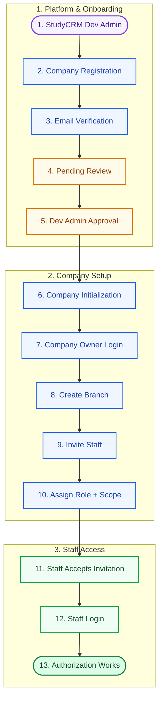
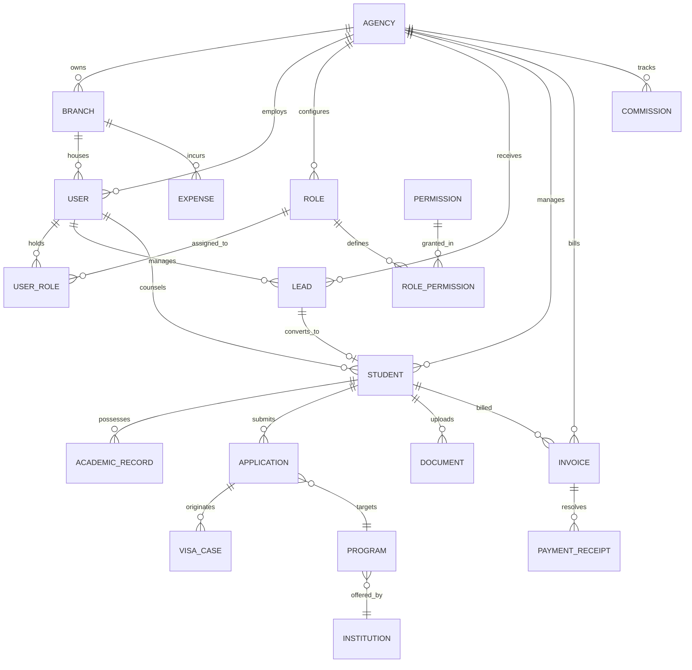

# Software Requirements Specification (SRS)
## For Study Track CRM (Study CRM Workspace)

**Document Reference:** `SRS-STRACK-2026-V3.1`  
**Standard:** IEEE Std 830-1998 / ISO/IEC/IEEE 29148:2018 Compliant  
**Initial Release Date:** 19 September 2026  
**Current Revision Date:** 25 October 2026  
**Status:** Approved & Baselined  
**Classification:** Confidential & Proprietary  

---

### Document Control & Revision History

| Version | Date | Author / Contributor | Description of Changes | Approved By |
| :--- | :--- | :--- | :--- | :--- |
| **1.0** | 19 Sep 2026 | Solution Architecture Team | Initial Draft: Core Lead & Student Workflow | Head of Operations |
| **2.0** | 08 Oct 2026 | Technical Lead & Systems Analyst | Added Multi-Application, Document Verification & Visa Cases | Lead Architect |
| **2.1** | 20 Oct 2026 | Security & Compliance Lead | Added Dynamic Role & Granular Permission System (RBAC) | CISO |
| **3.0** | 25 Oct 2026 | Core Engineering & Product Group | Full IEEE 830 Formal Restructure, Database DDL & Traceability | Executive Committee |
| **3.1** | 25 Oct 2026 | Enterprise SaaS Architecture Team | Added B2B Agency Onboarding: Sign-up, OTP, Demo Request, and Super Admin Approval Workflow | Platform Architect |

### Sign-off & Approval Matrix

| Role | Name | Title / Department | Signature / Status |
| :--- | :--- | :--- | :--- |
| **Platform Super Admin** | SaaS System Owner | Enterprise Cloud Solutions | *APPROVED* |
| **Agency Product Owner** | T. H. Talukder | Chief Executive Officer (CEO, Study Track) | *APPROVED* |
| **Operations Director** | Sarah Islam | Senior Recruitment & Operations Manager | *APPROVED* |
| **Lead Architect** | Engineering Lead | Enterprise Systems Division | *APPROVED* |
| **QA Director** | Quality Assurance Lead | Software Testing & Verification | *APPROVED* |

---

## Table of Contents
1. [Introduction](#1-introduction)
   - 1.1 [Purpose](#11-purpose)
   - 1.2 [Document Conventions](#12-document-conventions)
   - 1.3 [Intended Audience & Reading Suggestions](#13-intended-audience--reading-suggestions)
   - 1.4 [Project Scope & Multi-Tenant SaaS Model](#14-project-scope--multi-tenant-saas-model)
   - 1.5 [Applicable Standards & References](#15-applicable-standards--references)
   - 1.6 [Definitions, Acronyms, and Abbreviations](#16-definitions-acronyms-and-abbreviations)
2. [Overall Description](#2-overall-description)
   - 2.1 [Product Perspective & Two-Tier Admin Ecosystem](#21-product-perspective--two-tier-admin-ecosystem)
   - 2.2 [Product Functions Summary](#22-product-functions-summary)
   - 2.3 [User Classes and Characteristics (Platform vs Agency)](#23-user-classes-and-characteristics-platform-vs-agency)
   - 2.4 [Operating Environment](#24-operating-environment)
   - 2.5 [Design and Implementation Constraints](#25-design-and-implementation-constraints)
   - 2.6 [User Documentation](#26-user-documentation)
   - 2.7 [Assumptions and Dependencies](#27-assumptions-and-dependencies)
3. [System Features & Functional Requirements](#3-system-features--functional-requirements)
   - 3.1 [Agency Onboarding: Sign-Up, OTP Verification & Demo Workspace Request](#31-system-feature-agency-onboarding-sign-up-otp-verification--demo-workspace-request)
   - 3.2 [Authentication & Multi-Tenant Branch Management](#32-system-feature-authentication--multi-tenant-branch-management)
   - 3.3 [Dynamic Custom Role & Granular Permission Engine (RBAC)](#33-system-feature-dynamic-custom-role--granular-permission-engine-rbac)
   - 3.4 [Lead Capture, Deduping & Pipeline Engine](#34-system-feature-lead-capture-deduping--pipeline-engine)
   - 3.5 [Student Dossier & 360° Case Management](#35-system-feature-student-dossier--360-case-management)
   - 3.6 [Multi-Application Lifecycle Tracking](#36-system-feature-multi-application-lifecycle-tracking)
   - 3.7 [Document Review, Versioning & Quality Assurance](#37-system-feature-document-review-versioning--quality-assurance)
   - 3.8 [Visa Processing & Compliance Management](#38-system-feature-visa-processing--compliance-management)
   - 3.9 [Program Finder, Comparison & Eligibility Engine](#39-system-feature-program-finder-comparison--eligibility-engine)
   - 3.10 [Accounts, Service Invoicing & Commission Ledger](#310-system-feature-accounts-service-invoicing--commission-ledger)
   - 3.11 [Operations: Employee Attendance, Tasks & Appointments](#311-system-feature-operations-employee-attendance-tasks--appointments)
   - 3.12 [Communication Firewall & Student Self-Service Portal](#312-system-feature-communication-firewall--student-self-service-portal)
4. [External Interface Requirements](#4-external-interface-requirements)
   - 4.1 [User Interfaces (UI/UX)](#41-user-interfaces-uiux)
   - 4.2 [Hardware Interfaces](#42-hardware-interfaces)
   - 4.3 [Software Interfaces](#43-software-interfaces)
   - 4.4 [Communications Interfaces](#44-communications-interfaces)
5. [Non-Functional Requirements (NFR)](#5-non-functional-requirements-nfr)
   - 5.1 [Performance Requirements](#51-performance-requirements)
   - 5.2 [Safety & Backup Requirements](#52-safety--backup-requirements)
   - 5.3 [Security Requirements](#53-security-requirements)
   - 5.4 [Software Quality Attributes](#54-software-quality-attributes)
   - 5.5 [Core Business Rules (BR)](#55-core-business-rules-br)
6. [Data Requirements & Logical Schema](#6-data-requirements--logical-schema)
   - 6.1 [Logical Entity-Relationship Diagram](#61-logical-entity-relationship-diagram)
   - 6.2 [Data Dictionary & PostgreSQL DDL](#62-data-dictionary--postgresql-ddl)
7. [Verification & Traceability Matrix](#7-verification--traceability-matrix)
   - 7.1 [Requirements Traceability Matrix (RTM)](#71-requirements-traceability-matrix-rtm)
   - 7.2 [Acceptance Test Cases](#72-acceptance-test-cases)

---

## 1. Introduction

### 1.1 Purpose
This Software Requirements Specification (SRS) establishes the complete operational, functional, behavioral, and non-functional baseline for **Study Track CRM (Study CRM Workspace)**, Version 3.1. This document serves as the formal architectural blueprint governing the platform's multi-tenant SaaS architecture, agency onboarding lifecycle, custom role administration, and overseas student case workflows.

### 1.2 Document Conventions
This specification complies with IEEE Std 830-1998 and RFC 2119.
- **Requirement Identifiers:** Unique alphanumeric tags in the form `REQ-[MODULE]-[NUMBER]` (e.g., `REQ-AGY-001`, `REQ-LEAD-001`, `REQ-RBAC-004`).
- **Modal Verbs (RFC 2119):**
  - **SHALL / MUST:** Denotes an absolute, mandatory requirement for system compliance.
  - **SHOULD / RECOMMENDED:** Denotes a recommended design practice.
  - **MAY / OPTIONAL:** Denotes an elective feature.
  - **SHALL NOT / MUST NOT:** Denotes an absolute prohibition.
- **Priority Classification (MoSCoW):** Every requirement is designated as **Must Have (M)**, **Should Have (S)**, **Could Have (C)**, or **Won't Have (W)**.

### 1.3 Intended Audience & Reading Suggestions
1. **Platform Owner / SaaS Master Admins:** Read Section 1.4, Section 2.1, Section 2.3 (Platform Super Admin), and Section 3.1 (Agency Onboarding & Approval).
2. **Agency Executives / Agency Admins:** Read Section 2.3, Section 3.1 through Section 3.5, Section 3.10, and Section 5.5.
3. **Software Engineers & Solution Architects:** Review all sections in detail, with emphasis on Section 2, Section 3, Section 5, and Section 6 (PostgreSQL DDL).
4. **Quality Assurance Engineers:** Focus on Section 3 (Stimulus/Response), Section 5, and Section 7 (Acceptance & Traceability Matrix).

### 1.4 Project Scope & Multi-Tenant SaaS Model
Study Track CRM operates as a **Multi-Tenant B2B Software-as-a-Service (SaaS)** platform engineered for study-abroad agencies and visa consultancy businesses.

#### The Two-Tier Administrative Hierarchy:
1. **Tier 1: Platform Super Admin Panel (SaaS Provider / Platform Owner):**
   - High-level control over all registered agency organizations (tenants).
   - Manages incoming agency registrations, contact verifications, and demo/trial activation requests.
   - Evaluates agency business viability and provisions demo or production agency workspaces.
   - Manages platform-wide subscription billing, health metrics, and global system configurations.
2. **Tier 2: Agency Admin Panel (Tenant Workspace — e.g., Study Track):**
   - The dedicated operational command center for an approved educational agency.
   - Manages the agency's physical branches (e.g., Dhaka Head Office, Tangail Branch).
   - Configures custom roles, access permissions, counselors, admissions specialists, and accountants.
   - Manages student leads, applications, document screening, and commission receivables.

---

## 2. Overall Description

### 2.1 Product Perspective & Two-Tier Admin Ecosystem

```
+---------------------------------------------------------------------------------------------------------------+
|                                      PLATFORM SUPER ADMIN CONTROL PLANE                                       |
|                                         (SaaS Provider Master Panel)                                          |
|                                                                                                               |
| [ Agency Signup Flow ] ---> [ 6-Digit OTP Verification ] ---> [ Agency Submits Demo CRM Request ]             |
|                                                                              |                                |
|                                                                              v                                |
|                                                      +-----------------------------------+                    |
|                                                      | Super Admin Demo Review Queue     |                    |
|                                                      | - Verify Agency Identity & Volume |                    |
|                                                      | - [ APPROVE DEMO ] / [ REJECT ]   |                    |
|                                                      +-----------------------------------+                    |
|                                                                      |                                        |
+----------------------------------------------------------------------|----------------------------------------+
                                                                       | Provisions Isolated Tenant Workspace
                                                                       v
+---------------------------------------------------------------------------------------------------------------+
|                                         AGENCY ADMIN WORKSPACE (TENANT)                                       |
|                                            (e.g., Study Track Agency)                                         |
|                                                                                                               |
|  +---------------------------------------------------------------------------------------------------------+  |
|  | AGENCY ADMIN PANEL (Branch & Team Setup)                                                                |  |
|  | - Configure Branches: Dhaka Head Office, Tangail Branch                                                 |  |
|  | - Dynamic Role Builder: Senior Counselor, Canada Specialist, Finance Officer                           |  |
|  | - Staff Management & Biometric/IP Attendance Clock                                                      |  |
|  +---------------------------------------------------------------------------------------------------------+  |
|                                                      |                                                        |
|                                                      v                                                        |
|  +---------------------------------------------------------------------------------------------------------+  |
|  | AGENCY CORE CASE OPERATIONS                                                                             |  |
|  | - Lead Capture & Kanban Pipeline          - Multi-Application University Hub                            |  |
|  | - Student 360° Dossier Repository         - Quality Assurance Document Verification                     |  |
|  | - Program Finder & Eligibility Checker     - Country-Specific Visa Compliance (SDS, GS, CAS)             |  |
|  | - Agency BDT Invoicing & Receipts         - Foreign University Commission Aging                         |  |
|  +---------------------------------------------------------------------------------------------------------+  |
|                                                      |                                                        |
|                                                      v                                                        |
|  +---------------------------------------------------------------------------------------------------------+  |
|  | STUDENT SELF-SERVICE PORTAL                                                                             |  |
|  | - Progress Tracker (8 Stages)             - Document Replacement Station                                |  |
|  | - Service Invoice Review & Receipts       - Secure Messaging with Assigned Counselor                    |  |
|  +---------------------------------------------------------------------------------------------------------+  |
+---------------------------------------------------------------------------------------------------------------+
```

### 2.2 Product Functions Summary
1. **Agency Onboarding Engine:** Self-service registration, 6-digit OTP verification, demo CRM application submission, and automated approval notification.
2. **Tenant Provisioning Engine:** Sandbox creation, trial expiration countdown (14/30 days), and sample data initialization.
3. **Multi-Branch Hierarchy:** Isolated operational branches (e.g., Dhaka HQ, Tangail Branch) under single agency billing.
4. **Dynamic RBAC Engine:** Customizable security profiles featuring module action permissions and 3-tier data scopes (`OWN`, `BRANCH`, `GLOBAL`).
5. **Lead & Student Case Management:** De-duplicated lead capture, Kanban progression, and permanent 360° student dossiers.
6. **Multi-Application Tracking:** Independent parallel university submissions with document quality gating.
7. **Document Quality Screening:** Version-controlled file uploads with review notes and student remediation feedback.
8. **Dual-Currency Ledger:** Agency service fee billing (BDT) isolated from foreign university commissions (AUD, CAD, GBP, EUR, USD).

### 2.3 User Classes and Characteristics (Platform vs Agency)

| User Class | Administrative Tier | Typical User | Rights & System Scope |
| :--- | :--- | :--- | :--- |
| **Platform Super Admin** | **Platform Owner** | SaaS Provider CTO / Master Admin | Oversees all registered agencies; reviews demo requests; approves/suspends tenants; views global platform analytics. |
| **Agency Admin** | **Agency Tenant** | Agency CEO / Managing Director | Full control of their agency workspace: configures branches, creates custom roles, invites employees, monitors agency P&L. |
| **Branch Manager** | **Agency Tenant** | Head of Branch (Dhaka / Tangail) | Manages branch staff; reassigns leads; approves office expenses; oversees branch conversions and attendance. |
| **Senior Counselor** | **Agency Tenant** | Educational Counselor | Manages assigned leads; conducts profile evaluations; matches programs; creates application drafts. |
| **Admissions Officer** | **Agency Tenant** | University Admissions Specialist | Reviews academic documents; lodges university applications; records offer decisions. |
| **Visa Officer** | **Agency Tenant** | Visa Compliance Officer | Prepares country-specific visa files; verifies financial affidavits; records visa outcomes. |
| **Finance Officer** | **Agency Tenant** | Agency Accountant | Issues BDT service invoices; records MFS receipts; tracks foreign commission aging and branch expenses. |
| **Student** | **End User** | Prospective Overseas Student | Restricted to student portal: tracks application progress, uploads requested documents, reviews invoices. |

### 2.4 Operating Environment
- **Server Platform:** Linux (Ubuntu 22.04 LTS / Debian 12), Node.js LTS / Python containerized via Docker and Kubernetes.
- **Database Engine:** PostgreSQL 15+ with row-level security (RLS) enforcing tenant isolation (`agency_id`).
- **Client Web Browsers:** Evergreen browsers: Google Chrome (v110+), Mozilla Firefox (v110+), Apple Safari (v16+), Microsoft Edge (v110+).
- **Client Devices:** Responsive layout reflowing across desktop workstations, tablets, and smartphones down to $360\text{px}$ width.
- **File Storage Infrastructure:** Private cloud object store (AWS S3 / Google Cloud Storage) with bucket policies forbidding public read access.

### 2.5 Design and Implementation Constraints
1. **Multi-Tenant Data Isolation:** Queries for agency data must strictly include `agency_id` in execution filters or database Row-Level Security policies to prevent cross-tenant data leaks.
2. **Privacy Firewall:** Agency internal remarks, commission rates, and employee private notes must never leak to student portal views.
3. **Regulatory Compliance:** Adherence to Bangladesh Information and Communication Technology Act and international student data privacy guidelines (GDPR / FERPA standards).
4. **Network Resilience:** Mobile-first responsive optimization designed to function smoothly over $3\text{G}/4\text{G}$ mobile internet with latency up to $300\text{ ms}$.

### 2.6 User Documentation
- Platform Super Admin operations guide for tenant provisioning and demo request audits.
- Agency Admin onboarding guide for branch configuration and dynamic role setup.
- Interactive student guide within the self-service portal.

### 2.7 Assumptions and Dependencies
- Agency Admins maintain active corporate email and mobile accounts capable of receiving OTP tokens.
- Third-party email delivery services (SendGrid/SES) and SMS gateways maintain $\ge 99.5\%$ operational uptime.

---

## 3. System Features & Functional Requirements

```
                                  SYSTEM FEATURE ARCHITECTURE
+---------------------------------------------------------------------------------------------------------------+
|  3.1 AGENCY ONBOARDING & DEMO REQUEST WORKFLOW                                                                |
|      +-- REQ-AGY-001 (Agency Registration)         +-- REQ-AGY-002 (Contact OTP Verification)                 |
|      +-- REQ-AGY-003 (Demo Request Submission)     +-- REQ-AGY-004 (Super Admin Review Queue)                 |
|      +-- REQ-AGY-005 (Workspace Provisioning)      +-- REQ-AGY-006 (Agency Admin Panel Handover)              |
+---------------------------------------------------------------------------------------------------------------+
|  3.2 AUTHENTICATION & MULTI-TENANT WORKSPACES     |  3.3 DYNAMIC CUSTOM ROLES & RBAC ENGINE                   |
|      +-- REQ-AUTH-001 (Multi-Factor Login)        |      +-- REQ-RBAC-001 (Role Definition)                   |
|      +-- REQ-AUTH-002 (Branch Tenant Context)     |      +-- REQ-RBAC-002 (3-Tier Scope Modifiers)            |
+---------------------------------------------------+-----------------------------------------------------------+
|  3.4 LEAD CAPTURE & PIPELINE                      |  3.5 STUDENT DOSSIER (360° MANAGEMENT)                    |
|      +-- REQ-LEAD-001 (Normalized Ingestion)      |      +-- REQ-STU-001 (Master Dossier Generator)           |
|      +-- REQ-LEAD-002 (Collision Screening)       |      +-- REQ-STU-002 (Conversion Gate Gating)             |
+---------------------------------------------------+-----------------------------------------------------------+
|  3.6 MULTI-APPLICATION HUB                        |  3.7 DOCUMENT VERIFICATION & QUALITY QA                   |
|      +-- REQ-APP-001 (Multi-App Binding)          |      +-- REQ-DOC-001 (Country Checklist Repository)       |
|      +-- REQ-APP-002 (State Progression Machine)  |      +-- REQ-DOC-002 (Immutable Version Trees)            |
+---------------------------------------------------+-----------------------------------------------------------+
|  3.8 VISA PROCESSING & COMPLIANCE                 |  3.9 PROGRAM FINDER & MATCHMAKING                         |
|      +-- REQ-VISA-001 (Case Milestone Workflow)   |      +-- REQ-PROG-001 (Multi-Facet Filter Engine)         |
|      +-- REQ-VISA-002 (Compliance Screeners)      |      +-- REQ-PROG-002 (Algorithmic Fit Checker)           |
+---------------------------------------------------+-----------------------------------------------------------+
|  3.10 ACCOUNTS, INVOICING & COMMISSIONS           |  3.11 OPERATIONS & GOVERNANCE                             |
|      +-- REQ-FIN-001 (Agency Service Invoicing)   |      +-- REQ-OPS-001 (Biometric/IP Attendance Clock)      |
|      +-- REQ-FIN-002 (Foreign Commission Aging)   |      +-- REQ-OPS-002 (Task & Appointment Dispatch)        |
+---------------------------------------------------+-----------------------------------------------------------+
|  3.12 COMMUNICATION & STUDENT PORTAL                                                                          |
|      +-- REQ-PORT-001 (Student Tracker Station)    +-- REQ-COMM-001 (Dual-Channel Privacy Firewall)           |
+---------------------------------------------------------------------------------------------------------------+
```

---

### 3.1 System Feature: Agency Onboarding: Sign-Up, OTP Verification & Demo Workspace Request

#### 3.1.1 Description & Priority
Governs the public entry point for study abroad consultancy agencies, multi-channel contact verification, demo CRM application submission, and the Super Admin review and workspace activation workflow.  
**Priority:** Must Have (M).

#### 3.1.2 Stimulus / Response Sequences
- **Stimulus:** Agency representative navigates to the public signup page, inputs Organization Name, Admin Name, Email, Phone, and Password, and clicks "Create Account".
- **Response:** System validates input uniqueness, registers pending agency account, dispatches a 6-digit verification code to the email/phone, and renders the OTP verification view.
- **Stimulus:** Agency representative inputs the 6-digit OTP code.
- **Response:** System validates OTP; marks email/phone as verified; routes user to the "Request Demo CRM Workspace" form.
- **Stimulus:** Agency submits the Demo Request form specifying operational scope (e.g., branches: Dhaka & Tangail, estimated annual student intake: 200, message).
- **Response:** System transitions agency status to `PENDING_APPROVAL`, displays confirmation notice, and routes a priority notification to the Platform Super Admin Panel.
- **Stimulus:** Platform Super Admin opens the "Demo Requests Queue", reviews agency credentials, and clicks "Approve Demo".
- **Response:** System provisions an isolated agency tenant workspace (`agency_id`), initializes default branches, sets demo trial expiration (e.g., 14 days), generates the Agency Admin credentials, and sends an activation email with login link.

#### 3.1.3 Onboarding & Staff Authorization Lifecycle Flowchart



*For quick reference, see [FLOWCHART.md](file:///home/siam/projects/study_crm/FLOWCHART.md).*

#### 3.1.4 Functional Requirements
- **REQ-AGY-001:** The system SHALL provide a public Agency Registration interface capturing: `Organization Name`, `Agency Admin Full Name`, `Work Email Address`, `Phone / WhatsApp Number`, and `Password` (with confirmation).
- **REQ-AGY-002:** The system SHALL generate an automated 6-digit numeric verification OTP with a 5-minute Time-To-Live (TTL) upon agency signup and deliver it via transactional SMS/Email.
- **REQ-AGY-003:** The system SHALL permit only verified accounts to submit a Demo Workspace Request, capturing operational details: `Estimated Annual Student Volume`, `Primary Destination Countries`, `Planned Branch Count`, and `Consultancy License / Business Notes`.
- **REQ-AGY-004:** The system SHALL maintain a dedicated Agency Demo Requests Queue within the Platform Super Admin Panel, rendering all pending agencies with submission timestamp, verification status, and contact details.
- **REQ-AGY-005:** The Platform Super Admin Panel SHALL provide actions for each pending request:
  1. **Approve Demo:** Provisions a tenant workspace with a configurable trial period (default: 14 days), optional demo sandbox data, and transitions agency status to `DEMO_ACTIVE`.
  2. **Approve Full Production:** Transitions agency status to `ACTIVE` with permanent subscription parameters.
  3. **Reject Request:** Rejects request with mandatory explanation notes and transmits a formal rejection notification.
- **REQ-AGY-006:** Upon approval by the Platform Super Admin, the system SHALL immediately dispatch an activation confirmation containing the agency's dedicated workspace URL and grant the Agency Admin access to the **Agency Admin Panel**.

---

### 3.2 System Feature: Authentication & Multi-Tenant Branch Management

#### 3.2.1 Description & Priority
Governs secure authentication, cryptographic session issuance, and branch tenant data isolation within an approved agency workspace.  
**Priority:** Must Have (M).

#### 3.2.2 Stimulus / Response Sequences
- **Stimulus:** Staff user submits email and password from the agency login interface.
- **Response:** System validates credentials, verifies active agency subscription/demo status, issues signed JWT containing `agency_id`, `branch_id`, and roles, and routes user to their workspace.
- **Stimulus:** User enters an invalid password 5 consecutive times.
- **Response:** System locks user account for 15 minutes and writes an alert record to `security_audit_logs`.

#### 3.2.3 Functional Requirements
- **REQ-AUTH-001:** The system SHALL authenticate users using email and cryptographically hashed passwords (`bcrypt`, work factor $\ge 12$).
- **REQ-AUTH-002:** The system SHALL enforce Multi-Factor Authentication (MFA) via a 6-digit TOTP or SMS verification for all staff holding administrative or financial privileges.
- **REQ-AUTH-003:** The system SHALL inject `agency_id`, `branch_id`, `role_ids`, and permission arrays into the backend session context to enforce multi-tenant operational boundaries.
- **REQ-AUTH-004:** The system SHALL automatically invalidate web sessions after 30 minutes of continuous user inactivity.

---

### 3.3 System Feature: Dynamic Custom Role & Granular Permission Engine (RBAC)

#### 3.3.1 Description & Priority
Enables Agency Admins to create, name, configure, and assign custom roles with fine-grained action permissions and 3-tier data scoping modifiers (`OWN`, `BRANCH`, `GLOBAL`).  
**Priority:** Must Have (M).

#### 3.3.2 Stimulus / Response Sequences
- **Stimulus:** Agency Admin creates a custom role named *"Tangail Senior Counselor"* with `leads.view` (Scope: `BRANCH`) and `apps.create` (Scope: `OWN`).
- **Response:** System validates uniqueness within the agency, persists to `roles`, inserts mappings to `role_permissions`, and enables this role for branch staff assignment.
- **Stimulus:** Staff assigned to *"Tangail Senior Counselor"* attempts to query an API endpoint retrieving Dhaka branch leads (`GET /api/leads?branch=dhaka`).
- **Response:** Backend authorization middleware intercepts the request, evaluates the branch context, and returns an HTTP 403 Forbidden payload.

#### 3.3.3 Functional Requirements
- **REQ-RBAC-001:** The system SHALL maintain immutable System Roles (`Super Admin`, `Agency Admin`, `Student Portal User`) that cannot be deleted or stripped of fundamental access.
- **REQ-RBAC-002:** The system SHALL provide a Dynamic Role Builder interface in the Agency Admin Panel allowing managers to define custom role names, descriptions, and assign granular permissions.
- **REQ-RBAC-003:** Every permission assigned to a role SHALL incorporate one of three mutually exclusive Data Scope modifiers:
  1. `OWN`: Access restricted strictly to records where `assigned_to == user.id`.
  2. `BRANCH`: Access restricted to records matching the user's assigned branch (`record.branch_id == user.branch_id`).
  3. `GLOBAL`: Grants agency-wide access across all branches of that agency.
- **REQ-RBAC-004:** The system SHALL enforce an Anti-Privilege Escalation rule: No staff member SHALL create or modify a role to include permissions or data scopes exceeding their own access profile.
- **REQ-RBAC-005:** Access to `finance.view_commissions` and `rbac.manage_roles` SHALL be restricted exclusively to Agency Admins and designated senior executives.
- **REQ-RBAC-006:** The system SHALL block the deletion of any custom role while active staff members remain assigned to it.
- **REQ-RBAC-007:** When a staff user holds multiple roles, the authorization engine SHALL compute the union of granted permissions, resolving scope conflicts in favor of the highest scope (`GLOBAL` > `BRANCH` > `OWN`).

---

### 3.4 System Feature: Lead Capture, Deduping & Pipeline Engine

#### 3.4.1 Description & Priority
Captures prospective student inquiries, normalizes contact identifiers, detects duplicates, and presents an interactive Kanban pipeline with dedicated creation and conversion modal dialogs.  
**Priority:** Must Have (M).

```
+---------------------------------------------------------------------------------------------------------------+
|                                            LEAD PIPELINE WORKSPACE                                            |
| Search: [ Search leads...       ]      Branch: [ All Branches ▼ ]                     [ + Add New Lead ]      |
+--------------------+--------------------+--------------------+------------------------------------------------+
| NEW LEAD (12)      | COUNSELING (8)     | INTERESTED (6)     | APPLICATION (4)                                |
+--------------------+--------------------+--------------------+------------------------------------------------+
| [Avatar] LD-034345 | [Avatar] LD-034346 | [Avatar] LD-034347 | [Avatar] LD-034348                            |
| Zaire Westervelt   | Emerson Saris      | Sadia Noor         | Ayesha Rahman                                 |
| Phone: 01732423242 | Phone: 01812345678 | Phone: 01987654321 | Phone: 01711223344                            |
| Email: z@gmail.com | Email: e@gmail.com | Email: s@gmail.com | Email: a@gmail.com                            |
| Branch: Dhaka      | Branch: Dhaka      | Branch: Tangail    | Branch: Dhaka                                 |
| Couns: Sarah Islam | Couns: Sarah Islam | Couns: Rifat       | Couns: Sarah Islam                            |
| Country: CA-Canada | Country: Australia | Country: Finland   | Country: UK                                   |
| Prog: MSc Comp Sci | Prog: MBA          | Prog: Int Business | Prog: MSc Data Science                        |
|                    |                    |                    |                                                |
| [Move To Counseling| [Move To Interested| [Move To Applicat.]| [ File Opening / Start Application ] (Orange)  |
+--------------------+--------------------+--------------------+------------------------------------------------+
```

#### 3.4.2 Stimulus / Response Sequences
- **Stimulus:** Counselor clicks `+ Add New Lead` from the Lead Pipeline header.
- **Response:** System displays the **"Create New Lead"** modal dialog with auto-generated `Lead ID*` (e.g., `LD-034345`), full name, contact, email, branch, counselor, and target country/course fields.
- **Stimulus:** Counselor fills in details and clicks `Create Lead`.
- **Response:** System normalizes contact numbers (E.164), checks for collisions, persists lead record, and inserts a new card into the `New Lead` column.
- **Stimulus:** Counselor clicks `Move To Counseling` on a lead card.
- **Response:** Card transitions to `Counseling` column; system logs audit event and prompts for counseling session notes.
- **Stimulus:** Counselor clicks `Move To Interested` on a counseling lead card.
- **Response:** Card transitions to `Interested` column; updates next follow-up status.
- **Stimulus:** Counselor clicks `Move To Application` on an interested lead card.
- **Response:** Card transitions to `Application` column; displays the primary orange action button `File Opening / Start Application`.
- **Stimulus:** Counselor clicks `File Opening / Start Application` on an application lead card.
- **Response:** System displays the **"New File Opening"** comprehensive modal dialog prefilled with `Lead ID*` and `Full Name*`.

#### 3.4.3 Functional Requirements
- **REQ-LEAD-001 (Create New Lead PopUp Modal):** The system SHALL provide a modal dialog triggered by `+ Add New Lead` capturing:
  1. `Lead ID*`: System-generated alphanumeric identifier (e.g., `LD-034345`, read-only).
  2. `Full Name*`: Prospective student legal full name (text input).
  3. `Contact Number*`: Primary phone number (text input, E.164 validated).
  4. `Email*`: Email address (email input, lowercase normalized).
  5. `Branch*`: Dropdown selector (e.g., `Dhaka`, `Tangail`).
  6. `Assign Counsellor*`: Dropdown selector filtered by active counselors in selected branch.
  7. `Interested Country*`: Dropdown selector (e.g., `CA - Canada`, `AU - Australia`, `UK`, `FI - Finland`).
  8. `Interested Course*`: Course preference input/selector (e.g., `MSc Computer Science`).
  9. Submission button: `Create Lead` (primary action).
- **REQ-LEAD-002 (Algorithmic Deduplication):** Before inserting any lead, the system SHALL check for duplicate normalized phone numbers or lowercase email addresses within the agency tenant. Collisions SHALL abort creation, trigger a duplicate notification, and append the inquiry source to the existing file's activity feed.
- **REQ-LEAD-003 (Kanban Board Architecture & Direct Stage Buttons):** The system SHALL render a 4-column Kanban board: `New Lead`, `Counseling`, `Interested`, and `Application`. Each card SHALL display:
  - Header: Avatar initials, Lead ID (`LD-XXXXXX`), and context menu.
  - Body: Full Name, Phone, Email, Branch, Counselor, Interested Country, and Interested Program.
  - Footer Action Button:
    - On `New Lead`: Button labeled `Move To Counseling`.
    - On `Counseling`: Button labeled `Move To Interested`.
    - On `Interested`: Button labeled `Move To Application`.
    - On `Application`: Prominent primary button labeled `File Opening` / `Start Application`.
- **REQ-LEAD-004 (Stage Audit Logging):** Every button-triggered transition or drag-and-drop movement SHALL record an audit entry logging `lead_id`, `previous_stage`, `new_stage`, `acting_user_id`, and `timestamp`.

---

### 3.5 System Feature: Student Dossier & 360° Case Management (New File Opening Workflow)

#### 3.5.1 Description & Priority
Governs the formal student conversion process via the comprehensive **"New File Opening"** modal, initializing permanent student master dossiers and portal login credentials.  
**Priority:** Must Have (M).

```
+---------------------------------------------------------------------------------------------------------------+
|                                      POP-UP MODAL: NEW FILE OPENING                                       [X] |
+---------------------------------------------------------------------------------------------------------------+
| Lead ID*               [ ST-0324324          ] | Full Name*             [ Enter full name...            ]     |
| Email*                 [ Enter email...      ] | Password*              [ Enter password...             ]     |
| Contact Number*        [ Enter contact no... ] | What's App Number*     [ Enter WhatsApp number...      ]     |
| Branch*                [ Choose branch...  ▼ ] |                                                              |
| Reference*             [ Enter reference...  ] | Budget Idea*           [ Enter budget idea...          ]     |
| Interested Country*    [ Choose country... ▼ ] | Interested Course*     [ Choose courses...           ▼ ]     |
|                                                                                                               |
| ACADEMIC QUALIFICATION*                                                                                       |
| +----+-------------------------+--------------+----------------------+---------+                              |
| | No | Name of Exam            | Passing Year | Institution / Board  | Result  |                              |
| +----+-------------------------+--------------+----------------------+---------+                              |
| | 01 | SSC/Dakhil/O-Level      | 2016         | Dhaka Board          | 5.00    |                              |
| | 02 | HSC/Alim/Dip/A-Level    | 2018         | Dhaka Board          | 5.00    |                              |
| | 03 | Bachelor                | 2023         | Dhaka University     | 3.80    |                              |
| | 04 | Master's                | 2025         | Dhaka University     | 3.75    |                              |
| +----+-------------------------+--------------+----------------------+---------+                              |
|                                                                                                               |
| IELTS/PTE/TOEFL/Others*[ Enter score...      ] | Assign Counsellor*     [ Select counsellor...        ▼ ]     |
| Communication Note*    [ Enter communication note / remarks.................................. ]               |
|                                                                                                               |
|                                                     [ Create Student / Confirm File Opening ] (Primary Orange)|
+---------------------------------------------------------------------------------------------------------------+
```

#### 3.5.2 Stimulus / Response Sequences
- **Stimulus:** Counselor clicks `File Opening` / `Start Application` on an application card in the Kanban board.
- **Response:** System opens the **"New File Opening"** modal, automatically populating `Lead ID*` and existing contact fields.
- **Stimulus:** Counselor inputs `Password*` (for student portal access), `What's App Number*`, `Reference*`, `Budget Idea*`, fills the `Academic Qualification*` table, enters `IELTS/PTE Score`, and clicks `Create Student / Confirm File Opening`.
- **Response:** System validates mandatory fields (`BR-02`), creates student portal login, generates permanent ID `STU-26DHK-0248`, archives lead card as converted, and opens the Student 360° Master Dossier.

#### 3.5.3 Functional Requirements
- **REQ-STU-001 (New File Opening Modal Fields):** The system SHALL provide a dedicated modal dialog for student conversion capturing:
  1. `Lead ID*`: Pre-populated from lead (read-only).
  2. `Full Name*`: Official student name matching passport.
  3. `Email*` & `Password*`: Credentials used to provision the student self-service portal account.
  4. `Contact Number*` & `What's App Number*`: Separate contact telephone fields.
  5. `Branch*`: Selected agency branch dropdown.
  6. `Reference*`: Lead acquisition referral source (e.g., student referral, digital ad, agent).
  7. `Budget Idea*`: Declared financial budget for international tuition and living expenses.
  8. `Interested Country*` & `Interested Course*`: Target study destination and discipline.
  9. `Academic Qualification* Table`: Multi-row structured table capturing:
     - `No`: Sequential row index (`01`, `02`, `03`, `04`).
     - `Name of Exam`: Qualification category (`SSC/Dakhil/O-Level`, `HSC/Alim/Dip/A-Level`, `Bachelor`, `Master's`).
     - `Passing Year`: 4-digit calendar graduation year.
     - `Institution / Board`: Board of Intermediate and Secondary Education or University name.
     - `Result`: Cumulative GPA (scale of 5.00 or 4.00) or percentage.
  10. `IELTS/PTE/TOEFL/Others*`: Standardized English language proficiency examination overall score and bands.
  11. `Assign Counsellor*`: Designated case owner counselor.
  12. `Communication Note/Remarks*`: Initial intake counseling summary.
- **REQ-STU-002 (Student Master Dossier Generation):** Upon submission of the New File Opening form, the system SHALL:
  - Validate all mandatory fields (`BR-02`).
  - Encrypt `Password*` using `bcrypt` and instantiate the student portal login account.
  - Issue permanent Student ID `STU-[YY][BRANCH_CODE]-[0-9]{4}` (e.g., `STU-26DHK-0248`).
  - Store academic qualification rows in `academic_records` table.
  - Bind lead history, inquiries, and counseling notes into the student dossier timeline.
- **REQ-STU-003 (Students Overview Listing Screen):** The system SHALL provide a centralized Students Directory rendering:
  1. Top KPI Summary Metric Cards with month-over-month trends:
     - `Total Students`: Cumulative student count (e.g., `6,500` with `+3% from last month`).
     - `Active Students`: Active case files (e.g., `500` with `+3% from last month`).
     - `Application State`: Applications currently in review or submitted (e.g., `324`).
     - `Visa Processing`: Students in active visa compilation (e.g., `186`).
  2. Multi-Criteria Filter Bar:
     - Text Search: Real-time query matching Student Name, Student ID (`ST-XXXX`), or Phone Number.
     - Dropdown Filters: `Branch` (e.g., All, Dhaka, Tangail), `IELTS` score threshold, `Destination` country, and `Subject` discipline.
  3. Master Students Table:
     - Columns: `Student Id`, `Name`, `Branch`, `Destination`, `Phone`, `Email`, `Admission Date`, `Eng. Score`, `Application` (count of applications), `Status` (`Active` / `Inactive`), `Action`.
  4. Server-Side Pagination: `Showing 1-10 of [Total] Students` with page selector.

```
+---------------------------------------------------------------------------------------------------------------+
|                                            STUDENTS OVERVIEW DIRECTORY                                        |
| [ Total Students: 6,500 ]   [ Active Students: 500 ]   [ Application State: 324 ]   [ Visa Processing: 186 ]  |
+---------------------------------------------------------------------------------------------------------------+
| Search: [ Search by name, ID, phone... ]  Branch: [ All ▼ ]  IELTS: [ All ▼ ]  Dest: [ All ▼ ]  Subj: [ All ▼]|
+----------+------------------+---------+-------------+--------------------+-------+----------+--------+--------+
| Stud ID  | Name             | Branch  | Destination | Email              | IELTS | App Count| Status | Action |
+----------+------------------+---------+-------------+--------------------+-------+----------+--------+--------+
| STU-0248 | Rahat Khan       | Dhaka   | Canada      | rahman32@gmail.com | 6.50  | 05       | Active | [View] |
| ST-0201  | Zaire Westervelt | Dhaka   | Australia   | zaire@yahoo.com    | 6.00  | 02       | Active | [View] |
| ST-0202  | Emerson Saris    | Tangail | Canada      | emerson@yahoo.com  | 6.00  | 02       | Active | [View] |
+----------+------------------+---------+-------------+--------------------+-------+----------+--------+--------+
```

- **REQ-STU-004 (Student Details 360° Dossier & KPI Summary Cards):** The Student Details view SHALL display:
  - Header: Student Avatar, Full Name (`Rahat Khan`), Status Badge (`Active`), Student ID (`Student ID: STU-0248`), Joined Date (`Sep 12, 2026`), and Top Action Button `Export PDF`.
  - Top 4 Synchronized KPI Metric Widgets:
    1. `Applications`: Total and in-progress applications (e.g., `05 Applications` | `2 In Progress / 5 Total`).
    2. `Documents`: Document readiness ratio (e.g., `16 Document` | `08 Verified / 16 Total`).
    3. `Total Paid`: Cumulative payments collected (e.g., `7,435.00 USD` with `Payment Complete` badge).
    4. `Current Stage`: Global student milestone (e.g., `Offer Received` / `Visa Processing`).
  - Tab Navigation Bar: `Overview`, `Applications`, `Documents`, `Payments`, `Notes & Timeline`.

```
+---------------------------------------------------------------------------------------------------------------+
| STUDENT DOSSIER: Rahat Khan  [ Active ]  Student ID: STU-0248  Joined: Sep 12, 2026              [ Export PDF ]|
+---------------------------------------------------------------------------------------------------------------+
| [ 05 Applications ]          | [ 16 Documents ]             | [ 7,435.00 USD ]            | [ Current Stage ] |
| 2 In Progress / 5 Total      | 08 Verified / 16 Total       | Payment Complete            | Offer Received    |
+---------------------------------------------------------------------------------------------------------------+
| [ OVERVIEW ]   [ APPLICATIONS (05) ]   [ DOCUMENTS (16) ]   [ PAYMENTS ]   [ NOTES & TIMELINE ]               |
+---------------------------------------------------------------------------------------------------------------+
```

- **REQ-STU-005 (Dossier Tab 1: Overview Breakdown):**
  1. `Personal Info Card`: Counselor name, Email, Phone Number, WhatsApp Number, Current Address, Permanent Address, Date of Birth, Gender, Nationality, Marital Status.
  2. `Academic Info Card`: Highest & prior degrees: Bachelor (University, CGPA, Year), HSC (Board, GPA, Year), SSC (Board, GPA, Year), and English Language Test Score (IELTS overall & bands).
  3. `Passport Info Card`: Passport Number, Expiry Date, Issuing Country.
  4. `Profile Status Widget`: Circular progress indicator displaying completion percentage (e.g., `85% Complete` with Completed and Remaining breakdowns).
  5. `Upcoming Deadlines Widget`: Interactive list of pending student tasks with due dates (e.g., *Submit University Application Oct 05, 2026 [Pending Upload]*, *Upload Financial Document Oct 05, 2026 [Pending Upload]*).
  6. `Recent Activity Widget`: Chronological micro-feed of latest student updates (e.g., *Financial document uploaded Sep 28 · 10:12 AM*, *Offer received Sep 28 · 10:12 AM*, *Payment received — $500*).

- **REQ-STU-006 (Dossier Tab 2: Applications Sub-System):**
  - KPI Stat Bar: `Total` (05 Applications), `In Progress` (02 Applications), `Offers Received` (01 Applications), `Rejected` (02 Applications).
  - Applications Grid:
    - Columns: `No`, `University`, `Program`, `Intake`, `Application Fee`, `Type` (Degree Level, e.g., Master's), `Status` (`In Progress`, `Submitted`, `Offer Rcvd.`, `Draft`), `Deadline`.
    - Clicking any application row opens the **Application Timeline Slide-over Drawer**.

- **REQ-STU-007 (Dossier Tab 3: Documents Matrix):**
  - KPI Stat Bar: `Total Documents` (16), `Verified` (08), `Pending Review` (04), `Missing` (02).
  - Document Verification Table:
    - Columns: `No`, `Document Name`, `Category` (`Identity`, `Bachelor`, `HSC`, `Language`, `Financial`, `Application`), `Deadline`, `File` (`View` link / `Upload` button), `Uploaded Date/Time` (e.g., `01 Oct at 10:20am` or `Not upload yet`), `Status` (`Verified` [green tag], `Pending` [orange tag], `Missing` [gray/red tag]), `Action`.
    - Integrated document checklist covers: Passport, Academic Transcript Bachelor, Academic Transcript HSC, IELTS Certificate, Sponsor Letter, Recommendation Letter, Financial Solvency, and Bank Statement.

- **REQ-STU-008 (Dossier Tab 4: Payments Ledger):**
  - Displays agency fee payment confirmation banner: *"All required payments have been successfully received. No outstanding balance at this time."*
  - Shows total collected service revenue and itemized receipt vouchers.

- **REQ-STU-009 (Dossier Tab 5: Notes & Timeline with Milestone Stepper):**
  - Top Horizontal Milestone Stepper: Visual multi-step progress bar displaying sequential case stages:  
    `File Opening` $\longrightarrow$ `Counseling` $\longrightarrow$ `Application` $\longrightarrow$ `Offer Letter` $\longrightarrow$ `Visa Processing` $\longrightarrow$ `Enrollment`.
  - Chronological Activity Feed: Captures counselor consultation logs, system-triggered status updates, document uploads, and payment receipts with timestamp and author tags.
  - Interactive Follow-up Note Box allowing counselors to record private observations.

- **REQ-STU-010 (Application Timeline & Update State Slide-Over Drawer):**
  - The system SHALL provide a right-hand slide-over drawer triggered by clicking an application or "Update State" button.
  - Displays real-time milestone checkpoints under `Application Timeline` and `Visa Processing`.
  - Provides a primary action button `Update State` enabling authorized officers to lodge stage transitions.

---

### 3.6 System Feature: Multi-Application Lifecycle Tracking (Global Applications Hub)

#### 3.6.1 Description & Priority
Delivers an agency-wide application management dashboard allowing admissions teams to monitor university submissions across all active students, intakes, and partner institutions.  
**Priority:** Must Have (M).

```
+---------------------------------------------------------------------------------------------------------------+
|                                          GLOBAL APPLICATIONS DIRECTORY                                        |
| [ Total: 6,500 (+3%) ]   [ In Progress: 500 (+3%) ]   [ Offers Received: 324 (+3%) ]   [ Rejected: 186 (+3%) ]|
+---------------------------------------------------------------------------------------------------------------+
| Search: [ Search by name, ID, phone... ]  University: [ All ▼ ]  Intake: [ All ▼ ]  Prog: [ All ▼ ]  Status: [ All]|
+----------+------------------+------------------------+-----------------------+-----------+---------+----------+
| Stud ID  | Student Name     | University             | Program               | Intake    | Fee     | Status   |
+----------+------------------+------------------------+-----------------------+-----------+---------+----------+
| ST-0201  | Zaire Westervelt | University of Toronto  | Msc. Computer Science | Fall 2027 | $150.00 | In Progr.|
| ST-0201  | Emerson Saris    | University of Waterloo | Msc. Computer Science | Fall 2027 | $150.00 | In Progr.|
| ST-0201  | Jaxson Philips   | University of Alberta  | Msc. Computer Science | Fall 2027 | $120.00 | Submitted|
| ST-0201  | Martin Torff     | University of Waterloo | Msc. Data Science     | Fall 2027 | $180.00 | Offer Rcv|
+----------+------------------+------------------------+-----------------------+-----------+---------+----------+
```

#### 3.6.2 Stimulus / Response Sequences
- **Stimulus:** Admissions Specialist opens the global `Applications` screen.
- **Response:** System displays cumulative KPI metrics (`Total`, `In Progress`, `Offers Received`, `Rejected`), multi-field filters, and master application table.
- **Stimulus:** Officer filters by University: `University of Toronto` and Intake: `Fall 2027`.
- **Response:** Table instantly filters matching student applications with status badges and deadlines.
- **Stimulus:** Officer clicks on an application row.
- **Response:** System opens the **Application Timeline Slide-over Drawer** detailing status progression and enabling stage updates.

#### 3.6.3 Functional Requirements
- **REQ-APP-001 (Global Applications Directory):** The system SHALL provide an agency-wide applications table capturing: `Student ID`, `Student Name`, `University`, `Phone`, `Email`, `Program`, `Intake`, `Application Fee`, `Status`, and `Action`.
- **REQ-APP-002 (Global Application KPI Metric Cards):** The header SHALL render 4 summary metric widgets with month-over-month trend indicators: `Total Applications`, `In Progress`, `Offers Received`, and `Rejected`.
- **REQ-APP-003 (Sequential State Progression Machine):** Each application SHALL progress through a rigid sequential state machine:
  $$\text{Draft} \longrightarrow \text{In Progress} \longrightarrow \text{Submitted} \longrightarrow \begin{cases} \text{Offer Received (Conditional/Unconditional)} \\ \text{Rejected} \end{cases} \longrightarrow \text{Deposit Paid} \longrightarrow \text{Visa Processing} \longrightarrow \text{Enrolled}$$
- **REQ-APP-004 (Document Verification Gating):** An application SHALL NOT transition to `Submitted` unless all mandatory application documents for that program hold a `Verified` status badge.
- **REQ-APP-005 (Application Timeline Slide-over Drawer):** Clicking an application row SHALL open a contextual slide-over drawer displaying chronological milestone updates and allowing authorized admissions officers to update the application stage.

---

### 3.7 System Feature: Document Review, Versioning & Quality Assurance (Document Hub)

#### 3.7.1 Description & Priority
Delivers an agency-wide document management center for screening, verifying, and version-tracking all student identity, academic, language, and financial records.  
**Priority:** Must Have (M).

```
+---------------------------------------------------------------------------------------------------------------+
|                                            DOCUMENT VERIFICATION CENTER                                       |
| [ Total Docs: 6,500 (+3%) ]   [ Pending Review: 500 (+3%) ]   [ Verified: 324 (+3%) ]   [ Rejected: 186 (+3%) ]|
+---------------------------------------------------------------------------------------------------------------+
| Search: [ Search by student, file name... ]   Branch: [ All ▼ ]   Category: [ All ▼ ]   Status: [ All ▼ ]     |
+----------+------------------+---------------------+-----------+-------------+-----------+----------+----------+
| Stud ID  | Student Name     | Document Name       | Category  | Upload Date | File Size | Status   | Action   |
+----------+------------------+---------------------+-----------+-------------+-----------+----------+----------+
| STU-0248 | Rahat Khan       | Passport Scan       | Identity  | 01 Oct 2026 | 2.4 MB    | Verified | [Preview]|
| STU-0248 | Rahat Khan       | Bachelor Transcript | Academic  | 02 Oct 2026 | 4.1 MB    | Pending  | [Review] |
| ST-0201  | Zaire Westervelt | Bank Solvency Cert  | Financial | 28 Sep 2026 | 1.8 MB    | Rejected | [Re-eval]|
| ST-0202  | Emerson Saris    | IELTS Test Report   | Language  | 29 Sep 2026 | 850 KB    | Verified | [Preview]|
+----------+------------------+---------------------+-----------+-------------+-----------+----------+----------+
```

#### 3.7.2 Stimulus / Response Sequences
- **Stimulus:** Admissions/Visa Officer clicks `[Review]` on a pending document row.
- **Response:** System opens the **Document Preview Slide-over Drawer** rendering the file inline (PDF/image viewer) alongside metadata: student name, category, version (`v1`, `v2`), and upload timestamp.
- **Stimulus:** Officer clicks `Verify / Approve` in the preview drawer.
- **Response:** System updates document status to `Verified`, records reviewer User ID and timestamp, and notifies the assigned counselor.
- **Stimulus:** Officer clicks `Request Correction / Reject` and types: *"Final semester grade column is illegible; upload 300 DPI scan."*
- **Response:** System sets status to `Needs Correction` / `Rejected`, locks reviewer notes, and posts an urgent remediation alert to the student portal.

#### 3.7.3 Functional Requirements
- **REQ-DOC-001 (Document Directory & KPI Metrics):** The system SHALL provide an agency-wide Document Verification directory featuring 4 summary metric widgets: `Total Documents`, `Pending Review`, `Verified`, and `Rejected` with month-over-month trends.
- **REQ-DOC-002 (Document Filters & Table Columns):** The directory table SHALL provide search and filters (`Branch`, `Category`, `Status`) and display columns: `Student ID`, `Student Name`, `Document Name`, `Category`, `Upload Date`, `File Size/Type`, `Status`, and `Action`.
- **REQ-DOC-003 (Document Preview Slide-over Drawer):** Clicking `Action` SHALL open a slide-over drawer rendering the document preview alongside decision buttons:
  - `Verify / Approve`: Stamps file as `Verified` and locks it against modification.
  - `Request Correction / Reject`: Prompts for mandatory feedback remarks displayed directly on the student portal.
- **REQ-DOC-004 (Immutable Version Control):** Uploading replacement files SHALL increment the version counter (`v1`, `v2`, `v3`) without overwriting previous uploads.
- **REQ-DOC-005 (File Constraints & Pre-Signed URLs):** File uploads SHALL be restricted to MIME types `application/pdf`, `image/jpeg`, and `image/png` ($\le 10\text{ MB}$). Files SHALL be accessed exclusively via temporary pre-signed URLs expiring in $\le 15\text{ minutes}$.

---

### 3.8 System Feature: Visa Processing & Compliance Management

#### 3.8.1 Description & Priority
Governs post-admission visa file compilation, biometrics scheduling, embassy submission tracking, and visa outcome recording.  
**Priority:** Must Have (M).

```
+---------------------------------------------------------------------------------------------------------------+
|                                             VISA CASES MANAGEMENT                                             |
| [ Total Cases: 200 (+3%) ]   [ In Progress: 120 (+3%) ]   [ Approved / Granted: 55 ]   [ Refused: 25 (+3%) ]  |
+---------------------------------------------------------------------------------------------------------------+
| Search: [ Search by name, ID... ]     Country: [ All ▼ ]     Stage: [ All ▼ ]     Intake: [ All ▼ ]           |
|                                                                                      [ + Create Visa Case ]   |
+----------+------------------+-------------+-----------------------+-----------+-------------------+-----------+
| Case ID  | Student Name     | Destination | University            | Intake    | Stage             | Action    |
+----------+------------------+-------------+-----------------------+-----------+-------------------+-----------+
| VISA-101 | Rahat Khan       | Canada      | University of Toronto | Fall 2027 | Document Prep.    | [Timeline]|
| VISA-102 | Zaire Westervelt | Australia   | University of Sydney  | Feb 2027  | File Lodged       | [Timeline]|
| VISA-103 | Emerson Saris    | Canada      | University of Alberta | Fall 2027 | Biometrics Done   | [Timeline]|
| VISA-104 | Sadia Noor       | Finland     | Northern Coast UAS    | Aug 2027  | Visa Granted [OK] | [Timeline]|
+----------+------------------+-------------+-----------------------+-----------+-------------------+-----------+
```

#### 3.8.2 Stimulus / Response Sequences
- **Stimulus:** Visa Officer clicks `+ Create Visa Case`.
- **Response:** System displays the **"Create New Visa Case"** modal dialog with student search, accepted application selector, country, embassy file number, assigned officer, target lodge date, and notes.
- **Stimulus:** Officer submits the form.
- **Response:** System initializes visa case record `VISA-XXXX`, attaches destination compliance checklist, and inserts case into directory.
- **Stimulus:** Officer clicks `[Timeline]` on a visa row.
- **Response:** System opens the **Case Timeline Slide-Over Drawer** rendering sequential milestone stages (`Offer Letter Received` $\rightarrow$ `Tuition Deposit Paid` $\rightarrow$ `Visa File Prepared` $\rightarrow$ `Biometrics Scheduled` $\rightarrow$ `Lodged to Embassy` $\rightarrow$ `Decision Received`).

#### 3.8.3 Functional Requirements
- **REQ-VISA-001 (Visa Cases Directory & KPI Metrics):** The system SHALL provide a dedicated Visa Cases screen with 4 top KPI cards: `Total Visa Cases`, `In Progress`, `Approved / Granted`, and `Refused`.
- **REQ-VISA-002 (Create New Visa Case Modal):** The system SHALL provide a creation modal capturing:
  1. `Student*`: Searchable selector linking to active student.
  2. `Application*`: Dropdown filtered to applications holding accepted offer letters.
  3. `Destination Country*`: Auto-populated from application (e.g., Canada, Australia, UK).
  4. `Embassy Reference / Application No`: Official consular file tracking code.
  5. `Assigned Visa Officer*`: Designated compliance handler.
  6. `Target Submission Date`: Calendar date picker.
  7. `Case Notes`: Internal processing remarks.
- **REQ-VISA-003 (Case Timeline Slide-Over Drawer):** The system SHALL provide a slide-over drawer tracking the full visa journey:
  - Step 1: *Offer Letter Received & Verified*
  - Step 2: *Tuition Deposit Paid & Bank Swift Attached*
  - Step 3: *Visa Documents & Financial Solvency Compiled*
  - Step 4: *Biometrics / VFS Appointment Scheduled*
  - Step 5: *Application Lodged to High Commission / Embassy*
  - Step 6: *Visa Outcome Decided (Granted / Refused)*
- **REQ-VISA-004 (Visa Outcome Recording):** In the event of a visa refusal, the system SHALL mandate the upload of the official embassy refusal notice and record specific refusal grounds (`Financial Funds`, `Ties to Home Country`, `Academic Capability`) without deleting historical data.

---

### 3.9 System Feature: Program Finder, Comparison & Eligibility Engine

#### 3.9.1 Description & Priority
Provides a searchable institution and course catalogue featuring multi-criteria filtering, side-by-side program comparison, and automated application draft generation.  
**Priority:** Should Have (S).

```
+---------------------------------------------------------------------------------------------------------------+
|                                             PROGRAM FINDER CATALOGUE                                          |
| Search: [ Master of Business... ]   Country: [ Australia ▼ ]   Level: [ Postgraduate ▼ ]   Intake: [ Feb 2027]|
| Budget: [ AUD 35,000 / year    ]   Subject: [ Business   ▼ ]   English Test: [ IELTS  ▼ ]                     |
| [X] Scholarship Available   [X] Fee Waiver   [X] STEM Designated   [X] No GRE   [X] 15-Yrs Accepted           |
+---------------------------------------------------------------------------------------------------------------+
| Master of Business                  | MSc Business Analytics              | Bachelor of Computing             |
| Harbour University · Australia      | Northlake College · Canada          | Meridian Int Uni · Malaysia       |
| AUD 32,000 / year · 2 Years         | CAD 24,500 / year · 2 Years         | MYR 28,000 / year · 3 Years       |
| IELTS 6.5 (min 6.0) · PTE 58        | IELTS 6.5 (min 6.0) · PTE 60        | IELTS 6.0 (min 5.5) · PTE 50      |
|                                     |                                     |                                   |
| [ Check Eligibility ] [ Shortlist ] | [ Check Eligibility ] [ Shortlist ] | [ Check Eligibility ] [ Shortlist]|
| [ Apply Now ] (Primary Orange)      | [ Apply Now ] (Primary Orange)      | [ Apply Now ] (Primary Orange)    |
+---------------------------------------------------------------------------------------------------------------+
```

#### 3.9.2 Stimulus / Response Sequences
- **Stimulus:** Counselor filters catalogue by Destination: `Australia`, Intake: `February 2027`, Level: `Postgraduate`, Max Budget: `35,000 AUD`.
- **Response:** System renders matching course cards displaying institution, annual fee, IELTS/PTE criteria, duration, and intake availability.
- **Stimulus:** Counselor clicks `Apply Now` on a program card.
- **Response:** System displays the **"New Student Application"** modal dialog pre-filled with selected university, program title, fee, and intake term.
- **Stimulus:** Counselor selects student Rahat Khan (`STU-0248`) and clicks `Create Application Draft`.
- **Response:** System instantiates application `APP-XXXX`, links it to the student dossier, and opens the student application tab.

#### 3.9.3 Functional Requirements
- **REQ-PROG-001 (Multi-Facet Filter Engine):** The system SHALL provide search filtering by: `Destination Country`, `Region/City`, `Program Level`, `Study Discipline`, `Intake Month & Year`, `Annual Tuition Budget`, and `Currency`.
- **REQ-PROG-002 (Special Admission Flags):** The system SHALL support filter checkboxes: `Scholarship Listed`, `Application Fee Waiver`, `Open for Applications`, `STEM Designated`, `ESL/Pathway Included`, `No GRE Required`, `No Maths Prerequisite`, `Medium of Instruction (MOI) English Waiver`, `15-Year Education Accepted`.
- **REQ-PROG-003 (New Student Application Modal):** Clicking `Apply Now` on any program card SHALL open a modal dialog capturing:
  1. `Target Program & Institution`: Pre-filled (read-only).
  2. `Select Student*`: Searchable student dropdown with quick student creator link.
  3. `Intake Selection*`: Available intake term radio/selector.
  4. `Document Readiness Check`: Summary indicating which mandatory checklist items are already verified for this student.
  5. Action button: `Create Application Draft`.
- **REQ-PROG-004 (Algorithmic Eligibility Matcher):** The system SHALL evaluate active student profiles against program benchmarks, highlighting exact matches (Green) or specific deficits (Orange) in GPA, English bands, or tuition budgets.

---

### 3.10 System Feature: Task & Appointment Management

#### 3.10.1 Description & Priority
Coordinates daily counselor tasks, student counseling appointments, deadline reminders, and supervisor escalations.  
**Priority:** Should Have (S).

```
+---------------------------------------------------------------------------------------------------------------+
|                                            TASK & APPOINTMENT WORKSPACE                                       |
| Filter: [ All Counselors ▼ ]   Branch: [ Dhaka ▼ ]   Date: [ Today ▼ ]                [ + Create New Task ]   |
+--------------------------------------+--------------------------------------+---------------------------------+
| TODAY'S TASKS (5)                    | UPCOMING APPOINTMENTS (4)            | OVERDUE ESCALATIONS (2)         |
+--------------------------------------+--------------------------------------+---------------------------------+
| [ ] Review Ayesha's Transcript       | [Cal] In-Person Counseling: Rahat K. | [!] Verify Bank Statement       |
| Student: Ayesha Rahman (ST-1024)     | Time: 11:00 AM - 12:00 PM (Dhaka)   | Student: Emerson Saris          |
| Due: 21 Sep · Owner: Nadia           | Counselor: Sarah Islam               | Overdue by 24h · Owner: Rifat   |
| Priority: [ High ]                   | Room: Counseling Desk 02             | Priority: [ URGENT ]            |
+--------------------------------------+--------------------------------------+---------------------------------+
```

#### 3.10.2 Stimulus / Response Sequences
- **Stimulus:** Counselor clicks `+ Create New Task`.
- **Response:** System displays the **"Create New Task"** modal dialog with task title, assignee, student binder, date/time, and priority tier.
- **Stimulus:** Counselor submits the task.
- **Response:** System inserts task into assignee's queue, displays calendar reminder, and schedules notification 24 hours prior to deadline.
- **Stimulus:** Task deadline passes without being checked completed.
- **Response:** System automatically moves task to `Overdue Escalations` and alerts the Branch Manager.

#### 3.10.3 Functional Requirements
- **REQ-TASK-001 (Task & Appointment Board):** The system SHALL render categorized task columns: `Today's Tasks`, `Upcoming Appointments`, and `Overdue Escalations`.
- **REQ-TASK-002 (Create New Task Modal):** The system SHALL provide a creation modal capturing:
  1. `Task Title*`: Action item description (e.g., *"Review Ayesha's Transcript"*).
  2. `Assign To*`: Counselor dropdown.
  3. `Related Student`: Searchable student dropdown selector.
  4. `Due Date & Time*`: Calendar date/time picker.
  5. `Priority*`: Dropdown selector (`Normal`, `High`, `Urgent`).
  6. `Description / Remarks`: Detailed instructions.
- **REQ-TASK-003 (Task Completion & SLA Escalation):** Checking a task complete SHALL timestamp the record and clear alerts. Tasks remaining uncompleted after deadline SHALL automatically escalate to `Overdue` and notify branch management.

---

### 3.11 System Feature: Omni-Channel Communication Hub

#### 3.11.1 Description & Priority
Delivers an integrated messaging inbox for counselors to communicate with students across multiple channels while maintaining a strict privacy firewall against internal notes.  
**Priority:** Must Have (M).

```
+---------------------------------------------------------------------------------------------------------------+
|                                            OMNI-CHANNEL COMMUNICATION HUB                                     |
+--------------------------+-------------------------------------------------------+----------------------------+
| CONVERSATIONS (Search)   | ACTIVE CHAT: Rahat Khan (STU-0248 · Canada · Sarah)   | STUDENT QUICK DOSSIER      |
+--------------------------+-------------------------------------------------------+----------------------------+
| [Avatar] Rahat Khan      | [Rahat Khan · 10:14 AM]                               | Name: Rahat Khan           |
| "I uploaded the scan..." | Hello Sarah, I uploaded the final transcript page.    | Phone: +880 1732-423242    |
| 10:15 AM · [WhatsApp]    |                                                       | Target: Canada (MSc CS)    |
|                          | [Sarah Islam · 10:16 AM]                              | Stage: Offer Received      |
| [Avatar] Zaire W.        | Received Rahat. Our admissions team is reviewing now. |                            |
| "When is the deadline?"  |                                                       | [Quick Notes / Follow-up]  |
| Yesterday · [Portal]     | +---------------------------------------------------+ | "Parent meeting scheduled  |
|                          | | Type your message here...                  [Send] | |  for next Monday."         |
|                          | +---------------------------------------------------+ |                            |
+--------------------------+-------------------------------------------------------+----------------------------+
```

#### 3.11.2 Stimulus / Response Sequences
- **Stimulus:** Counselor selects Rahat Khan from the conversation list.
- **Response:** Center pane loads chat history; right pane loads Student Quick Dossier (contact, destination, stage, follow-up notes).
- **Stimulus:** Counselor types a message and clicks `Send`.
- **Response:** System delivers message to student self-service portal (and WhatsApp if connected), logs event, and updates thread preview.

#### 3.11.3 Functional Requirements
- **REQ-COMM-001 (Unified Conversation List):** The system SHALL display conversation threads tagged by channel (`Portal Message`, `WhatsApp`, `Email`, `SMS`) with unread badge indicators and search.
- **REQ-COMM-002 (Message Thread Pane):** The chat window SHALL display chronological incoming and outgoing messages with delivery timestamps, author signatures, and file attachments.
- **REQ-COMM-003 (Student Quick Dossier Sidebar):** The communication view SHALL display a persistent right-hand sidebar rendering the student's key profile metadata: Full Name, Phone, Target Country, Application Stage, and Counselor Private Notes.
- **REQ-COMM-004 (Data Privacy Firewall):** Counselor Private Notes entered in the quick dossier SHALL NOT be transmitted to student-facing channels or APIs.

---

### 3.12 System Feature: Accounts & Finance Dashboard

#### 3.12.1 Description & Priority
Administers agency service fee billing (BDT), university commission aging (foreign currencies), and branch office operational expense approvals.  
**Priority:** Must Have (M).

```
+---------------------------------------------------------------------------------------------------------------+
|                                            ACCOUNTS & FINANCE DASHBOARD                                       |
| [ Total Revenue (BDT) ]      | [ Commission Received ]      | [ Pending Receivables ]      | [ Office Expenses]|
| ৳ 50,00,000 (+3% MoM)        | ৳ 12,20,000 (Equivalent)     | ৳ 8,50,000                   | ৳ 4,20,000 (BDT)  |
+---------------------------------------------------------------------------------------------------------------+
| [ STUDENT SERVICE INVOICES ]       [ UNIVERSITY COMMISSIONS ]       [ OFFICE EXPENSES & APPROVALS ]           |
+----------+------------------+---------------------+--------------+--------+---------------+-------------------+
| Inv No   | Student Name     | Service Description | Amount (BDT) | Method | Status        | Action            |
+----------+------------------+---------------------+--------------+--------+---------------+-------------------+
| ST-INV026| Rahat Khan       | App Support Service | ৳ 5,000      | bKash  | Paid [OK]     | [View Receipt]    |
| ST-INV027| Zaire Westervelt | Visa File Opening   | ৳ 10,000     | Bank   | Paid [OK]     | [View Receipt]    |
| ST-INV028| Emerson Saris    | Full Case Package   | ৳ 15,000     | --     | Unpaid [Warn] | [Send Reminder]   |
+----------+------------------+---------------------+--------------+--------+---------------+-------------------+
```

#### 3.12.2 Stimulus / Response Sequences
- **Stimulus:** Finance Officer opens the `Accounts & Finance` dashboard.
- **Response:** System displays 4 high-level KPI metric cards (`Total Revenue`, `Total Commission Received`, `Pending Receivables`, `Total Office Expenses`) and tabbed financial ledgers.
- **Stimulus:** Officer clicks `[View Receipt]` on a paid invoice.
- **Response:** System generates a branded PDF payment receipt (`ST-RCP-XXXX`) with tax invoice number, student ID, payment method, and signature.
- **Stimulus:** Officer navigates to `University Commissions` tab.
- **Response:** System displays international receivables grouped by aging ($>30, >60, >90$ days) in original foreign currencies (AUD, CAD, GBP, EUR, USD).

#### 3.12.3 Functional Requirements
- **REQ-FIN-001 (Finance KPI Metrics Bar):** The system SHALL display 4 global financial KPI cards:
  1. `Total Revenue (BDT)`: Cumulative collected agency service fees.
  2. `Total Commission Received`: Foreign university commissions cleared into local bank accounts.
  3. `Pending Receivables`: Invoiced commissions and unpaid student fees awaiting clearance.
  4. `Total Office Expenses`: Cumulative approved branch operational costs.
- **REQ-FIN-002 (Tabbed Financial Sub-Systems):** The finance module SHALL provide three distinct ledger sub-views:
  - *Student Service Invoices:* BDT billing for student counseling, file opening, and visa packages.
  - *University Commissions:* Multi-currency commission tracking against partner university intake enrollments.
  - *Office Expenses & Approvals:* Branch utility, rent, internet, and stationery expense claims requiring manager sign-off.
- **REQ-FIN-003 (Strict Multi-Currency Isolation):** Agency service fee transactions SHALL be maintained exclusively in Bangladeshi Taka (BDT); university commissions SHALL be calculated and tracked in their foreign currencies until official bank credit advice reconciliation.

---

## 4. External Interface Requirements

### 4.1 User Interfaces (UI/UX)
- **Design System Standards:** The user interface SHALL comply with modern design standards featuring high-contrast text ratios ($\ge 4.5:1$ per WCAG 2.1 AA), systematic typography (Inter / Roboto sans-serif stack), curved border radiuses ($8\text{px}$ to $16\text{px}$), and responsive CSS grid/flexbox layouts.
- **Theme Support:** Native light and dark color schemes via standard CSS custom properties (`light-dark()`, OkLab color mixing).
- **Navigation Architecture:** Fixed lateral sidebar with categorized menus:
  - *Main Menu:* Dashboard, Lead Pipeline, Students, Applications, Document Review, Visa Cases, Program Finder.
  - *Operations:* Tasks & Appointments, Communication, Accounts & Finance, Reports & Insights, Partner Institutes, Branches, Attendance, Team Management.
  - *Support:* Customer Support.
- **Interactive Feedback:** Contextual toast alerts (`st-ok`, `st-warn`, `st-danger`) for asynchronous transactions, inline field validation errors, and clear modal confirmation dialogues for destructive actions.

### 4.2 Hardware Interfaces
No dedicated hardware interfaces required. The platform operates on standard commercial computing equipment supporting modern web standards.

### 4.3 Software Interfaces
1. **Object Storage Service:** Amazon Web Services (AWS) S3 API / Google Cloud Storage API for encrypted document file persistence.
2. **Transactional Email Service:** SMTP / REST API integration (Mailgun, Amazon SES, or SendGrid) for OTP verification and automated deadline alerts.
3. **WhatsApp Business Cloud API:** Meta Graph API integration for automated template-based milestone notifications.
4. **Payment Gateway Integration:** SSLCommerz / bKash Merchant API for processing student service charges in Bangladeshi Taka (BDT).

### 4.4 Communications Interfaces
- **Network Protocol:** HTTPS enforcing Transport Layer Security (TLS 1.3). All unencrypted HTTP traffic SHALL be redirected to HTTPS with HTTP Strict Transport Security (HSTS) headers enabled.
- **API Architectural Style:** RESTful JSON APIs adhering to OpenAPI 3.0 standards.
- **Real-Time Data Channels:** WebSockets (WSS) / Server-Sent Events (SSE) for real-time task alerts and instant portal messaging.

---

## 5. Non-Functional Requirements (NFR)

### 5.1 Performance Requirements
- **REQ-NFR-PERF-01 (Catalog Search Latency):** Program Finder search queries filtering over a catalogue of 20,000 courses SHALL return complete results within $\le 600\text{ ms}$ under standard broadband.
- **REQ-NFR-PERF-02 (Dashboard Load Time):** Dashboard and Kanban board views SHALL achieve a 95th-percentile First Contentful Paint (FCP) of $\le 1.2\text{ seconds}$ for branches containing up to 50,000 student records.
- **REQ-NFR-PERF-03 (System Concurrency):** The production infrastructure SHALL sustain at least 300 concurrent staff users and 2,000 concurrent student portal users with zero HTTP 5xx error anomalies.

### 5.2 Safety & Backup Requirements
- **REQ-NFR-SAFE-01 (Automated Disaster Recovery):** The database engine SHALL execute automated snapshot backups daily with write-ahead log (WAL) archiving to guarantee Point-in-Time Recovery (PITR).
- **REQ-NFR-SAFE-02 (Recovery Metrics):** The system SHALL achieve a Recovery Point Objective (RPO) of $\le 1\text{ hour}$ and a Recovery Time Objective (RTO) of $\le 4\text{ hours}$ in the event of primary data center disruption.

### 5.3 Security Requirements
- **REQ-NFR-SEC-01 (Data Encryption):** All personal identifiable information (passport numbers, dates of birth, national identity numbers, and sponsor financial balances) SHALL be encrypted at rest using AES-256-GCM.
- **REQ-NFR-SEC-02 (Storage Security):** Document files stored in object storage buckets SHALL block public read access; all file access SHALL require pre-signed URLs expiring in $\le 15\text{ minutes}$.
- **REQ-NFR-SEC-03 (Authentication Security):** Passwords SHALL be hashed using `bcrypt` (work factor $\ge 12$). API access tokens SHALL expire in 15 minutes; refresh tokens SHALL expire in 7 days and employ single-use refresh token rotation.
- **REQ-NFR-SEC-04 (Vulnerability Hardening):** All input parameters SHALL be sanitized and bound via parameterized queries to eliminate SQL Injection (SQLi), Cross-Site Scripting (XSS), and Cross-Site Request Forgery (CSRF).

### 5.4 Software Quality Attributes
- **Availability:** The system SHALL guarantee $\ge 99.9\%$ operational uptime per calendar month, excluding scheduled maintenance windows announced 48 hours in advance.
- **Maintainability:** Codebases SHALL follow modular component architecture with comprehensive API documentation and strict separation of data access, business logic, and presentation tiers.
- **Usability:** All critical operations (creating a lead, submitting an application, approving a document) SHALL be executable in $\le 4$ user clicks from the dashboard.

### 5.5 Core Business Rules (BR)

| Rule ID | Rule Title | Formal Specification |
| :--- | :--- | :--- |
| **BR-01** | Lead Deduping & Collision | Incoming inquiries sharing an E.164 phone or lowercase email with an existing lead/student SHALL NOT generate a duplicate file; data SHALL append to the existing timeline. |
| **BR-02** | File Opening Gate | Transitioning a lead to `File Opening` mandates Full Name, Verified Phone, Email, Branch, Counselor, Valid Academic Record, Target Country, Target Intake, and Budget. |
| **BR-03** | Application Submission Gate | An application SHALL NOT transition to `Submitted` unless all mandatory application documents for that institution possess a `Verified` status badge. |
| **BR-04** | Document Immutability | Uploading a replacement document SHALL archive the existing file as `v[N]` and increment the active file to `v[N+1]`. Previous versions SHALL NOT be deleted. |
| **BR-05** | Financial Isolation | Agency fee invoices (BDT) and University Tuition/Commissions (foreign currency) SHALL be stored in separate ledger tables. Forecast commission is never recognized as collected revenue. |
| **BR-06** | Commission Privacy | Institutional commission rates, university agreements, and profit margins SHALL NEVER be exposed to Counselor, Student, or public API views. |
| **BR-07** | Custom Role Integrity | System roles cannot be deleted. Custom roles cannot grant permissions exceeding the creator's permissions. Active assigned roles cannot be deleted. |
| **BR-08** | Agency Onboarding & Demo Lifecycle | An agency cannot access an Agency Admin Panel until its phone/email is verified via OTP and its Demo/Production request is formally approved by a Platform Super Admin. Demo workspaces automatically lock upon reaching trial expiration. |

---

## 6. Data Requirements & Logical Schema

### 6.1 Logical Entity-Relationship Diagram



---

### 6.2 Data Dictionary & PostgreSQL DDL

```sql
-- ============================================================================
-- 0. PLATFORM LEVEL: AGENCIES & DEMO WORKSPACE ONBOARDING
-- ============================================================================
CREATE TABLE agencies (
    id SERIAL PRIMARY KEY,
    name VARCHAR(150) NOT NULL,
    slug VARCHAR(100) UNIQUE NOT NULL, -- e.g., 'study-track'
    admin_name VARCHAR(100) NOT NULL,
    admin_email VARCHAR(120) UNIQUE NOT NULL,
    admin_phone VARCHAR(30) UNIQUE NOT NULL,
    password_hash VARCHAR(255) NOT NULL,
    is_phone_verified BOOLEAN DEFAULT FALSE,
    is_email_verified BOOLEAN DEFAULT FALSE,
    status VARCHAR(30) NOT NULL DEFAULT 'PENDING_APPROVAL', 
    -- PENDING_APPROVAL, DEMO_ACTIVE, ACTIVE, REJECTED, SUSPENDED, EXPIRED
    demo_duration_days INT DEFAULT 14,
    demo_expires_at TIMESTAMP WITH TIME ZONE,
    approved_by_user_id INT, -- Platform Super Admin ID
    approved_at TIMESTAMP WITH TIME ZONE,
    rejection_reason TEXT,
    created_at TIMESTAMP WITH TIME ZONE DEFAULT CURRENT_TIMESTAMP,
    updated_at TIMESTAMP WITH TIME ZONE DEFAULT CURRENT_TIMESTAMP
);

CREATE TABLE agency_demo_requests (
    id SERIAL PRIMARY KEY,
    agency_id INT NOT NULL REFERENCES agencies(id) ON DELETE CASCADE,
    planned_branches INT DEFAULT 1,
    estimated_annual_students INT DEFAULT 50,
    target_destinations TEXT, -- e.g., 'Canada, Australia, UK'
    business_license_no VARCHAR(100),
    notes TEXT,
    submitted_at TIMESTAMP WITH TIME ZONE DEFAULT CURRENT_TIMESTAMP
);

-- ============================================================================
-- 1. BRANCHES & MULTI-TENANCY
-- ============================================================================
CREATE TABLE branches (
    id SERIAL PRIMARY KEY,
    agency_id INT NOT NULL REFERENCES agencies(id) ON DELETE CASCADE,
    name VARCHAR(100) NOT NULL,
    code VARCHAR(10) NOT NULL, -- e.g., 'DHK', 'TGL'
    address TEXT NOT NULL,
    phone VARCHAR(30) NOT NULL,
    is_active BOOLEAN DEFAULT TRUE,
    created_at TIMESTAMP WITH TIME ZONE DEFAULT CURRENT_TIMESTAMP,
    updated_at TIMESTAMP WITH TIME ZONE DEFAULT CURRENT_TIMESTAMP,
    UNIQUE (agency_id, code)
);

-- ============================================================================
-- 2. STAFF USERS & AUTHENTICATION
-- ============================================================================
CREATE TABLE users (
    id SERIAL PRIMARY KEY,
    agency_id INT NOT NULL REFERENCES agencies(id) ON DELETE CASCADE,
    branch_id INT REFERENCES branches(id) ON DELETE RESTRICT,
    name VARCHAR(100) NOT NULL,
    email VARCHAR(120) NOT NULL,
    password_hash VARCHAR(255) NOT NULL,
    phone VARCHAR(30),
    is_agency_admin BOOLEAN DEFAULT FALSE,
    is_active BOOLEAN DEFAULT TRUE,
    failed_login_attempts INT DEFAULT 0,
    locked_until TIMESTAMP WITH TIME ZONE,
    created_at TIMESTAMP WITH TIME ZONE DEFAULT CURRENT_TIMESTAMP,
    updated_at TIMESTAMP WITH TIME ZONE DEFAULT CURRENT_TIMESTAMP,
    UNIQUE (agency_id, email)
);

-- ============================================================================
-- 3. DYNAMIC ROLES & GRANULAR PERMISSIONS (RBAC)
-- ============================================================================
CREATE TABLE roles (
    id SERIAL PRIMARY KEY,
    agency_id INT NOT NULL REFERENCES agencies(id) ON DELETE CASCADE,
    name VARCHAR(100) NOT NULL,
    slug VARCHAR(100) NOT NULL,
    description TEXT,
    is_system BOOLEAN DEFAULT FALSE,
    branch_id INT REFERENCES branches(id) ON DELETE SET NULL, -- NULL = Global Agency Role
    created_by INT REFERENCES users(id) ON DELETE SET NULL,
    created_at TIMESTAMP WITH TIME ZONE DEFAULT CURRENT_TIMESTAMP,
    updated_at TIMESTAMP WITH TIME ZONE DEFAULT CURRENT_TIMESTAMP,
    UNIQUE (agency_id, slug)
);

CREATE TABLE permissions (
    id SERIAL PRIMARY KEY,
    module VARCHAR(50) NOT NULL,   -- e.g., 'leads', 'students', 'apps', 'finance'
    action VARCHAR(50) NOT NULL,   -- e.g., 'view', 'create', 'edit', 'delete', 'verify'
    code VARCHAR(100) UNIQUE NOT NULL, -- e.g., 'leads.view', 'docs.verify'
    description TEXT
);

CREATE TABLE role_permissions (
    role_id INT NOT NULL REFERENCES roles(id) ON DELETE CASCADE,
    permission_id INT NOT NULL REFERENCES permissions(id) ON DELETE CASCADE,
    data_scope VARCHAR(20) NOT NULL DEFAULT 'BRANCH', -- 'OWN', 'BRANCH', 'GLOBAL'
    PRIMARY KEY (role_id, permission_id)
);

CREATE TABLE user_roles (
    user_id INT NOT NULL REFERENCES users(id) ON DELETE CASCADE,
    role_id INT NOT NULL REFERENCES roles(id) ON DELETE RESTRICT,
    assigned_at TIMESTAMP WITH TIME ZONE DEFAULT CURRENT_TIMESTAMP,
    assigned_by INT REFERENCES users(id) ON DELETE SET NULL,
    PRIMARY KEY (user_id, role_id)
);

-- ============================================================================
-- 4. LEADS & RECRUITMENT PIPELINE
-- ============================================================================
CREATE TABLE leads (
    id SERIAL PRIMARY KEY,
    agency_id INT NOT NULL REFERENCES agencies(id) ON DELETE CASCADE,
    lead_code VARCHAR(30) NOT NULL, -- e.g., 'ST-0324324'
    branch_id INT NOT NULL REFERENCES branches(id) ON DELETE RESTRICT,
    assigned_to INT REFERENCES users(id) ON DELETE SET NULL,
    name VARCHAR(100) NOT NULL,
    phone VARCHAR(30) NOT NULL,
    whatsapp VARCHAR(30),
    email VARCHAR(120),
    destination VARCHAR(50) NOT NULL,
    course_preference VARCHAR(150),
    budget_amount NUMERIC(12,2),
    stage VARCHAR(30) NOT NULL DEFAULT 'New Enquiry',
    source VARCHAR(50) NOT NULL,
    created_at TIMESTAMP WITH TIME ZONE DEFAULT CURRENT_TIMESTAMP,
    updated_at TIMESTAMP WITH TIME ZONE DEFAULT CURRENT_TIMESTAMP,
    UNIQUE (agency_id, lead_code)
);

-- ============================================================================
-- 5. STUDENT MASTER DOSSIERS
-- ============================================================================
CREATE TABLE students (
    id SERIAL PRIMARY KEY,
    agency_id INT NOT NULL REFERENCES agencies(id) ON DELETE CASCADE,
    student_code VARCHAR(30) NOT NULL, -- e.g., 'STU-26DHK-0248'
    lead_id INT UNIQUE REFERENCES leads(id) ON DELETE RESTRICT,
    branch_id INT NOT NULL REFERENCES branches(id) ON DELETE RESTRICT,
    counselor_id INT REFERENCES users(id) ON DELETE SET NULL,
    name VARCHAR(100) NOT NULL,
    dob DATE,
    gender VARCHAR(20),
    nationality VARCHAR(50) DEFAULT 'Bangladeshi',
    passport_no VARCHAR(50),
    passport_expiry DATE,
    passport_country VARCHAR(50) DEFAULT 'Bangladesh',
    status VARCHAR(30) DEFAULT 'Active',
    created_at TIMESTAMP WITH TIME ZONE DEFAULT CURRENT_TIMESTAMP,
    updated_at TIMESTAMP WITH TIME ZONE DEFAULT CURRENT_TIMESTAMP,
    UNIQUE (agency_id, student_code)
);

CREATE TABLE academic_records (
    id SERIAL PRIMARY KEY,
    student_id INT NOT NULL REFERENCES students(id) ON DELETE CASCADE,
    exam_name VARCHAR(100) NOT NULL, -- SSC, HSC, Bachelor, Master's
    passing_year INT NOT NULL,
    institution_or_board VARCHAR(150) NOT NULL,
    grade_or_score NUMERIC(5,2) NOT NULL,
    scale NUMERIC(5,2) DEFAULT 4.00,
    created_at TIMESTAMP WITH TIME ZONE DEFAULT CURRENT_TIMESTAMP
);

CREATE TABLE language_tests (
    id SERIAL PRIMARY KEY,
    student_id INT NOT NULL REFERENCES students(id) ON DELETE CASCADE,
    test_type VARCHAR(20) NOT NULL, -- IELTS, PTE, TOEFL, DET
    overall_score NUMERIC(4,1) NOT NULL,
    listening NUMERIC(4,1),
    reading NUMERIC(4,1),
    writing NUMERIC(4,1),
    speaking NUMERIC(4,1),
    test_date DATE,
    created_at TIMESTAMP WITH TIME ZONE DEFAULT CURRENT_TIMESTAMP
);

-- ============================================================================
-- 6. PARTNER INSTITUTIONS, PROGRAMS & APPLICATIONS
-- ============================================================================
CREATE TABLE institutions (
    id SERIAL PRIMARY KEY,
    agency_id INT NOT NULL REFERENCES agencies(id) ON DELETE CASCADE,
    name VARCHAR(150) NOT NULL,
    country VARCHAR(50) NOT NULL,
    region VARCHAR(100),
    commission_rate_percent NUMERIC(5,2) DEFAULT 15.00,
    created_at TIMESTAMP WITH TIME ZONE DEFAULT CURRENT_TIMESTAMP
);

CREATE TABLE programs (
    id SERIAL PRIMARY KEY,
    institution_id INT NOT NULL REFERENCES institutions(id) ON DELETE CASCADE,
    name VARCHAR(150) NOT NULL,
    degree_level VARCHAR(50) NOT NULL,
    study_area VARCHAR(100) NOT NULL,
    intake_month VARCHAR(20) NOT NULL,
    intake_year VARCHAR(10) NOT NULL,
    duration VARCHAR(30) NOT NULL,
    annual_tuition NUMERIC(12,2) NOT NULL,
    currency VARCHAR(10) NOT NULL,
    min_qualification VARCHAR(50) NOT NULL,
    min_grade NUMERIC(5,2) NOT NULL,
    min_ielts_overall NUMERIC(3,1),
    min_ielts_band NUMERIC(3,1),
    min_pte_overall NUMERIC(4,1),
    min_pte_band NUMERIC(4,1),
    is_open BOOLEAN DEFAULT TRUE,
    is_stem BOOLEAN DEFAULT FALSE,
    is_scholarship_available BOOLEAN DEFAULT FALSE,
    created_at TIMESTAMP WITH TIME ZONE DEFAULT CURRENT_TIMESTAMP
);

CREATE TABLE applications (
    id SERIAL PRIMARY KEY,
    app_code VARCHAR(30) UNIQUE NOT NULL, -- e.g., 'APP-2401'
    student_id INT NOT NULL REFERENCES students(id) ON DELETE CASCADE,
    program_id INT NOT NULL REFERENCES programs(id) ON DELETE RESTRICT,
    stage VARCHAR(50) NOT NULL DEFAULT 'Draft',
    action_item VARCHAR(255),
    action_due_date DATE,
    offer_type VARCHAR(50),
    created_at TIMESTAMP WITH TIME ZONE DEFAULT CURRENT_TIMESTAMP,
    updated_at TIMESTAMP WITH TIME ZONE DEFAULT CURRENT_TIMESTAMP
);

-- ============================================================================
-- 7. DOCUMENTS & VERIFICATION
-- ============================================================================
CREATE TABLE documents (
    id SERIAL PRIMARY KEY,
    student_id INT NOT NULL REFERENCES students(id) ON DELETE CASCADE,
    app_id INT REFERENCES applications(id) ON DELETE SET NULL,
    name VARCHAR(150) NOT NULL,
    category VARCHAR(50) NOT NULL,
    storage_path TEXT NOT NULL,
    version INT NOT NULL DEFAULT 1,
    status VARCHAR(30) NOT NULL DEFAULT 'In Review',
    reviewer_notes TEXT,
    verified_by INT REFERENCES users(id) ON DELETE SET NULL,
    verified_at TIMESTAMP WITH TIME ZONE,
    created_at TIMESTAMP WITH TIME ZONE DEFAULT CURRENT_TIMESTAMP,
    updated_at TIMESTAMP WITH TIME ZONE DEFAULT CURRENT_TIMESTAMP
);

-- ============================================================================
-- 8. VISA CASES & COMPLIANCE
-- ============================================================================
CREATE TABLE visa_cases (
    id SERIAL PRIMARY KEY,
    student_id INT NOT NULL REFERENCES students(id) ON DELETE CASCADE,
    app_id INT UNIQUE NOT NULL REFERENCES applications(id) ON DELETE RESTRICT,
    country VARCHAR(50) NOT NULL,
    checklist_template VARCHAR(50) NOT NULL,
    stage VARCHAR(50) NOT NULL DEFAULT 'Document Preparation',
    embassy_reference_no VARCHAR(100),
    lodged_date DATE,
    biometrics_date DATE,
    decision_date DATE,
    outcome VARCHAR(30) DEFAULT 'Pending',
    refusal_reason TEXT,
    created_at TIMESTAMP WITH TIME ZONE DEFAULT CURRENT_TIMESTAMP,
    updated_at TIMESTAMP WITH TIME ZONE DEFAULT CURRENT_TIMESTAMP
);

-- ============================================================================
-- 9. FINANCIAL LEDGERS, INVOICES & EXPENSES
-- ============================================================================
CREATE TABLE invoices (
    id SERIAL PRIMARY KEY,
    agency_id INT NOT NULL REFERENCES agencies(id) ON DELETE CASCADE,
    invoice_no VARCHAR(50) NOT NULL, -- e.g., 'ST-INV-026'
    student_id INT NOT NULL REFERENCES students(id) ON DELETE RESTRICT,
    branch_id INT NOT NULL REFERENCES branches(id) ON DELETE RESTRICT,
    description VARCHAR(255) NOT NULL,
    amount NUMERIC(12,2) NOT NULL,
    currency VARCHAR(10) NOT NULL DEFAULT 'BDT',
    status VARCHAR(30) NOT NULL DEFAULT 'Unpaid',
    created_by INT REFERENCES users(id) ON DELETE SET NULL,
    created_at TIMESTAMP WITH TIME ZONE DEFAULT CURRENT_TIMESTAMP,
    updated_at TIMESTAMP WITH TIME ZONE DEFAULT CURRENT_TIMESTAMP,
    UNIQUE (agency_id, invoice_no)
);

CREATE TABLE receipts (
    id SERIAL PRIMARY KEY,
    receipt_no VARCHAR(50) UNIQUE NOT NULL,
    invoice_id INT UNIQUE NOT NULL REFERENCES invoices(id) ON DELETE RESTRICT,
    amount_paid NUMERIC(12,2) NOT NULL,
    currency VARCHAR(10) NOT NULL DEFAULT 'BDT',
    payment_method VARCHAR(50) NOT NULL,
    received_by INT REFERENCES users(id) ON DELETE SET NULL,
    received_at TIMESTAMP WITH TIME ZONE DEFAULT CURRENT_TIMESTAMP
);

CREATE TABLE commissions (
    id SERIAL PRIMARY KEY,
    agency_id INT NOT NULL REFERENCES agencies(id) ON DELETE CASCADE,
    app_id INT UNIQUE NOT NULL REFERENCES applications(id) ON DELETE CASCADE,
    institution_id INT NOT NULL REFERENCES institutions(id) ON DELETE RESTRICT,
    forecast_amount NUMERIC(12,2) NOT NULL,
    currency VARCHAR(10) NOT NULL,
    status VARCHAR(30) NOT NULL DEFAULT 'Forecast',
    bank_advice_reference VARCHAR(100),
    received_at TIMESTAMP WITH TIME ZONE,
    created_at TIMESTAMP WITH TIME ZONE DEFAULT CURRENT_TIMESTAMP
);

CREATE TABLE office_expenses (
    id SERIAL PRIMARY KEY,
    agency_id INT NOT NULL REFERENCES agencies(id) ON DELETE CASCADE,
    branch_id INT NOT NULL REFERENCES branches(id) ON DELETE RESTRICT,
    description VARCHAR(255) NOT NULL,
    amount NUMERIC(12,2) NOT NULL,
    currency VARCHAR(10) NOT NULL DEFAULT 'BDT',
    status VARCHAR(30) NOT NULL DEFAULT 'Pending',
    submitted_by INT NOT NULL REFERENCES users(id),
    approved_by INT REFERENCES users(id),
    receipt_storage_path TEXT,
    created_at TIMESTAMP WITH TIME ZONE DEFAULT CURRENT_TIMESTAMP
);

-- ============================================================================
-- 10. TASKS & APPOINTMENTS MANAGEMENT
-- ============================================================================
CREATE TABLE tasks (
    id SERIAL PRIMARY KEY,
    agency_id INT NOT NULL REFERENCES agencies(id) ON DELETE CASCADE,
    branch_id INT REFERENCES branches(id) ON DELETE RESTRICT,
    title VARCHAR(255) NOT NULL,
    description TEXT,
    assigned_to INT NOT NULL REFERENCES users(id) ON DELETE CASCADE,
    student_id INT REFERENCES students(id) ON DELETE SET NULL,
    due_date TIMESTAMP WITH TIME ZONE NOT NULL,
    priority VARCHAR(20) NOT NULL DEFAULT 'Normal', -- 'Low', 'Normal', 'High', 'Urgent'
    status VARCHAR(30) NOT NULL DEFAULT 'Pending',   -- 'Pending', 'In Progress', 'Completed', 'Overdue'
    created_by INT REFERENCES users(id) ON DELETE SET NULL,
    completed_at TIMESTAMP WITH TIME ZONE,
    created_at TIMESTAMP WITH TIME ZONE DEFAULT CURRENT_TIMESTAMP,
    updated_at TIMESTAMP WITH TIME ZONE DEFAULT CURRENT_TIMESTAMP
);

CREATE TABLE appointments (
    id SERIAL PRIMARY KEY,
    agency_id INT NOT NULL REFERENCES agencies(id) ON DELETE CASCADE,
    branch_id INT NOT NULL REFERENCES branches(id) ON DELETE RESTRICT,
    title VARCHAR(255) NOT NULL,
    student_id INT NOT NULL REFERENCES students(id) ON DELETE CASCADE,
    counselor_id INT NOT NULL REFERENCES users(id) ON DELETE CASCADE,
    appointment_type VARCHAR(50) NOT NULL, -- 'In-Person', 'Virtual Zoom', 'Phone Counseling'
    scheduled_start TIMESTAMP WITH TIME ZONE NOT NULL,
    scheduled_end TIMESTAMP WITH TIME ZONE NOT NULL,
    room_or_link VARCHAR(255),
    status VARCHAR(30) NOT NULL DEFAULT 'Scheduled', -- 'Scheduled', 'Completed', 'Cancelled', 'No-Show'
    notes TEXT,
    created_at TIMESTAMP WITH TIME ZONE DEFAULT CURRENT_TIMESTAMP
);

-- ============================================================================
-- 11. OMNI-CHANNEL COMMUNICATIONS & MESSAGING
-- ============================================================================
CREATE TABLE communication_threads (
    id SERIAL PRIMARY KEY,
    agency_id INT NOT NULL REFERENCES agencies(id) ON DELETE CASCADE,
    student_id INT NOT NULL REFERENCES students(id) ON DELETE CASCADE,
    channel VARCHAR(30) NOT NULL DEFAULT 'Portal', -- 'Portal', 'WhatsApp', 'Email', 'SMS'
    external_thread_id VARCHAR(100),
    counselor_quick_notes TEXT,
    last_message_at TIMESTAMP WITH TIME ZONE DEFAULT CURRENT_TIMESTAMP,
    created_at TIMESTAMP WITH TIME ZONE DEFAULT CURRENT_TIMESTAMP
);

CREATE TABLE communication_messages (
    id SERIAL PRIMARY KEY,
    thread_id INT NOT NULL REFERENCES communication_threads(id) ON DELETE CASCADE,
    sender_type VARCHAR(20) NOT NULL, -- 'Staff', 'Student', 'System'
    sender_user_id INT REFERENCES users(id) ON DELETE SET NULL,
    content TEXT NOT NULL,
    attachment_storage_path TEXT,
    is_private_internal_note BOOLEAN DEFAULT FALSE,
    is_read BOOLEAN DEFAULT FALSE,
    read_at TIMESTAMP WITH TIME ZONE,
    created_at TIMESTAMP WITH TIME ZONE DEFAULT CURRENT_TIMESTAMP
);

-- ============================================================================
-- 12. OPERATIONS: ATTENDANCE & SECURITY AUDIT LOGS
-- ============================================================================
CREATE TABLE attendance (
    id SERIAL PRIMARY KEY,
    agency_id INT NOT NULL REFERENCES agencies(id) ON DELETE CASCADE,
    user_id INT NOT NULL REFERENCES users(id) ON DELETE CASCADE,
    branch_id INT NOT NULL REFERENCES branches(id) ON DELETE RESTRICT,
    check_in TIMESTAMP WITH TIME ZONE NOT NULL,
    check_out TIMESTAMP WITH TIME ZONE,
    ip_address VARCHAR(45) NOT NULL
);

CREATE TABLE security_audit_logs (
    id BIGSERIAL PRIMARY KEY,
    agency_id INT REFERENCES agencies(id) ON DELETE CASCADE,
    acting_user_id INT REFERENCES users(id) ON DELETE SET NULL,
    client_ip VARCHAR(45) NOT NULL,
    event_type VARCHAR(100) NOT NULL,
    target_entity VARCHAR(50) NOT NULL,
    target_entity_id INT NOT NULL,
    before_state JSONB,
    after_state JSONB,
    timestamp TIMESTAMP WITH TIME ZONE DEFAULT CURRENT_TIMESTAMP
);
```

---

## 7. Verification & Traceability Matrix

### 7.1 Requirements Traceability Matrix (RTM)

| Requirement ID | System Feature | Design Element / DDL Table | Acceptance Test Case |
| :--- | :--- | :--- | :--- |
| `REQ-AGY-001` | Agency Public Registration | `agencies`, `agencies.admin_email` | `TC-AGY-001` |
| `REQ-AGY-002` | Agency OTP Verification | `agencies.is_phone_verified` | `TC-AGY-001` |
| `REQ-AGY-003` | Demo Request Submission | `agency_demo_requests` | `TC-AGY-001` |
| `REQ-AGY-004` | Super Admin Approval Queue | `agencies.status`, Super Admin Panel| `TC-AGY-001` |
| `REQ-AGY-006` | Agency Admin Panel Access | `users.is_agency_admin`, JWT Session| `TC-AGY-001` |
| `REQ-AUTH-001` | Staff Authentication | `users`, `bcrypt` hashing | `TC-AUTH-001` |
| `REQ-AUTH-003` | Branch Multi-Tenancy | `branches`, `users.branch_id` | `TC-TENANT-001` |
| `REQ-RBAC-002` | Custom Role Builder | `roles`, `role_permissions` | `TC-RBAC-001` |
| `REQ-RBAC-003` | 3-Tier Data Scoping | `role_permissions.data_scope` | `TC-RBAC-002` |
| `REQ-RBAC-004` | Anti-Escalation Rule | Authorization Middleware Guard | `TC-RBAC-003` |
| `REQ-LEAD-001` | Lead Intake Normalization | `leads.phone`, `leads.email` | `TC-LEAD-001` |
| `REQ-LEAD-002` | Deduplication Collision | E.164 Regex & Lead Lookup Query | `TC-LEAD-002` |
| `REQ-STU-001` | Student Dossier Generator | `students`, `students.student_code` | `TC-STU-001` |
| `REQ-STU-002` | Conversion Gating | Conversion Validation Service | `TC-STU-002` |
| `REQ-APP-001` | Multi-Application Binding | `applications.student_id` | `TC-APP-001` |
| `REQ-APP-004` | Application Submission Gate | `applications.stage`, `documents.status`| `TC-APP-002` |
| `REQ-DOC-002` | Document Version Control | `documents.version`, `storage_path` | `TC-DOC-001` |
| `REQ-DOC-005` | Document Verification Stamp| `documents.verified_by`, `verified_at` | `TC-DOC-002` |
| `REQ-VISA-002` | Country Visa Checklists | `visa_cases.checklist_template` | `TC-VISA-001` |
| `REQ-PROG-004` | Eligibility Fit Checker | `programs`, `academic_records` | `TC-PROG-001` |
| `REQ-FIN-001` | Dual Ledger Isolation | `invoices` (BDT) vs `commissions` | `TC-FIN-001` |
| `REQ-COMM-001` | Data Privacy Firewall | API Serializer Scoping Filters | `TC-COMM-001` |

---

### 7.2 Acceptance Test Cases

```
                                  ACCEPTANCE TESTING FLOW
+---------------------------+     +------------------------+     +------------------------+
| 1. Agency Onboard & Demo  |     | 2. Security & RBAC     |     | 3. Core Case Workflows |
| TC-AGY-001 (Signup to     |     | TC-RBAC-001 (Role DDL) |     | TC-LEAD-002 (Dedup)    |
| Super Admin Approval &    | --> | TC-RBAC-002 (Scope)    | --> | TC-STU-002 (Conv Gate) |
| Agency Admin Workspace)   |     | TC-RBAC-003 (Anti-Esc) |     | TC-APP-002 (Doc Gate)  |
+---------------------------+     +------------------------+     +------------------------+
```

#### Test Case ID: `TC-AGY-001`
- **Feature:** End-to-End Agency Onboarding: Sign-up, OTP Verification, Demo CRM Request, and Super Admin Approval.
- **Pre-conditions:** Platform Super Admin panel is active. Agency `Study Track International` is unregistered.
- **Execution Steps:**
  1. Agency representative visits public signup page, enters Organization Name `"Study Track International"`, Admin Name `"T. H. Talukder"`, Email `"ceo@studytrack.com"`, Phone `"01711000000"`, Password, and submits.
  2. System receives signup, generates 6-digit OTP, and renders verification screen.
  3. Agency enters the OTP code.
  4. Upon verification, agency completes Demo Request form: specifies 2 branches (`Dhaka`, `Tangail`), expected student volume `200`, and submits.
  5. Platform Super Admin logs into **Platform Super Admin Panel**, navigates to *Agency Demo Requests*, reviews the submission, and clicks *"Approve Demo (14 Days)"*.
  6. System transitions agency status to `DEMO_ACTIVE`, provisions tenant workspace (`agency_id`), and sends activation email.
  7. Agency Admin clicks login link, enters credentials, and logs in.
- **Expected Outcome:** Agency Admin lands in their dedicated **Agency Admin Panel**, sees zero cross-tenant contamination, and can immediately add branches (`Dhaka`, `Tangail`) and invite counselors.
- **Pass/Fail Criteria:** Pass if registration, verification, Super Admin approval queue, and isolated workspace provisioning succeed with full audit trail.

#### Test Case ID: `TC-RBAC-001`
- **Feature:** Custom Role Builder and Dynamic Assignment.
- **Pre-conditions:** Agency Admin authenticated in Agency Admin Panel.
- **Execution Steps:**
  1. Navigate to *Roles & Permissions Management*.
  2. Click *"+ Create Custom Role"*.
  3. Enter Name: `"Tangail Admissions Specialist"`.
  4. Select `apps.view` (Scope: `BRANCH`), `docs.verify` (Scope: `BRANCH`).
  5. Assign role to user `Rifat` (Tangail branch).
- **Expected Outcome:** User `Rifat` successfully logs in and can view/verify all documents for Tangail branch students, but receives HTTP 403 when requesting Dhaka branch records or financial commission reports.
- **Pass/Fail Criteria:** Pass if data isolation strictly holds and permission audit log is generated.

#### Test Case ID: `TC-LEAD-002`
- **Feature:** Algorithmic Deduplication & Collision Management.
- **Pre-conditions:** Lead `Ayesha Rahman` exists in database with normalized phone `+8801732423242`.
- **Execution Steps:**
  1. Intake counselor inputs a new web inquiry with name `Ayesha R.`, phone `01732423242`, and email `ayesha@example.com`.
  2. Click *"Create Lead"*.
- **Expected Outcome:** System detects duplicate phone match after E.164 normalization, aborts creation of a second row in `leads`, renders a duplicate alert modal, and appends the web inquiry to the existing timeline.
- **Pass/Fail Criteria:** Pass if `leads` count remains unchanged and existing timeline records the event.

#### Test Case ID: `TC-STU-002`
- **Feature:** File Opening Conversion Gate Gating.
- **Pre-conditions:** Lead exists in `Counseling` stage with empty academic records.
- **Execution Steps:**
  1. Counselor drags lead into `File Opening`.
- **Expected Outcome:** Transition is rejected; system displays modal: *"Conversion Blocked: Missing mandatory academic history, target country, and budget."* Card snaps back to prior stage.
- **Pass/Fail Criteria:** Pass if state transition fails and student record is not created.

#### Test Case ID: `TC-APP-002`
- **Feature:** Document Verification Gating for Application Lodgment.
- **Pre-conditions:** Application `APP-2401` has Bachelor Transcript in `Needs Correction` status.
- **Execution Steps:**
  1. Admissions officer opens application and clicks *"Submit to University"*.
- **Expected Outcome:** System blocks submission action and alerts user: *"Mandatory documents require verification before lodgment."*
- **Pass/Fail Criteria:** Pass if application status remains `Draft` / `Under Review`.

#### Test Case ID: `TC-DOC-001`
- **Feature:** Document Replacement Version Control.
- **Pre-conditions:** Document `Bachelor transcript` exists as `v1` with status `Needs Correction`.
- **Execution Steps:**
  1. Student logs into portal and selects a replacement PDF file `transcript_final.pdf` ($4.2\text{ MB}$).
  2. Click *"Upload Replacement"*.
- **Expected Outcome:** File `v1` is archived; new file is persisted as `v2`; status automatically switches to `In Review`; admissions officer receives a review alert.
- **Pass/Fail Criteria:** Pass if both files exist in storage and `documents.version` evaluates to `2`.

#### Test Case ID: `TC-FIN-001`
- **Feature:** Dual Ledger Currency Isolation.
- **Pre-conditions:** Student holds an accepted offer at Harbour University ($32,000\text{ AUD}$ tuition).
- **Execution Steps:**
  1. Issue agency service invoice for BDT 5,000.
  2. Record university tuition deposit confirmation of AUD 4,000.
- **Expected Outcome:** Agency invoice is booked to BDT operational accounts; tuition deposit is credited to admissions case record in AUD; institutional commission forecast ($15\% = 4,800\text{ AUD}$) is logged to commissions table without booking as revenue.
- **Pass/Fail Criteria:** Pass if agency BDT revenue ledger reflects zero foreign currency exposure.

---

### Appendix: Conformance Checklist

- [x] **Two-Tier SaaS Architecture:** Complete separation between Platform Super Admin Panel (SaaS Provider) and Agency Admin Panel (Tenant Workspace).
- [x] **Self-Service Agency Onboarding:** Comprehensive workflow covering Registration $\rightarrow$ OTP Contact Verification $\rightarrow$ Demo CRM Request $\rightarrow$ Super Admin Review & Provisioning $\rightarrow$ Agency Admin Panel Handover.
- [x] **IEEE 830-1998 Sectional Alignment:** Full compliance across Introduction, Overall Description, System Features, External Interfaces, NFRs, Data Schemas, and Verification Matrix.
- [x] **RFC 2119 Compliance:** Strict application of SHALL, SHALL NOT, and SHOULD modal verbs.
- [x] **Traceability:** Complete bi-directional mapping from Requirement IDs to Acceptance Tests.
- [x] **Production DDL:** Fully typed PostgreSQL relational schema with tenant isolation (`agency_id`), foreign key constraints, indexes, and audit logging tables.
